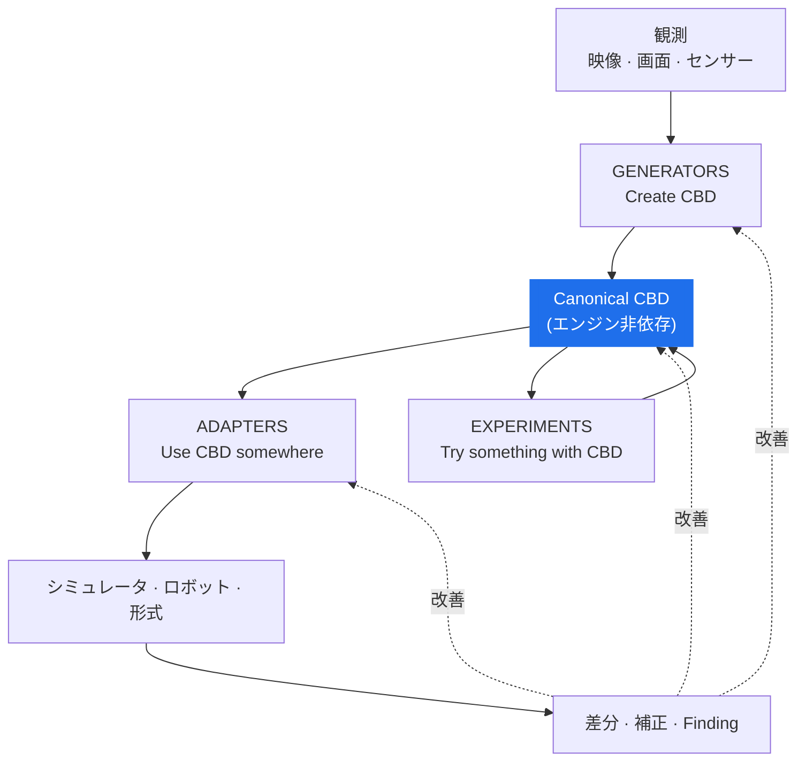

<div align="center">

# Common Behavior Data

**Behavior should be portable.（行動は、持ち運べるべきだ）**

観測された行動を、シミュレータ・ロボット・モデル・ツールをまたいで
**再利用可能な資産**に変えるためのオープンなフレームワークです。

*行動を一度生成し、異なる環境へ適応させ、何が壊れるかを計測し、
移植性を改善し続ける。*

[](docs/limitations.md)
[](LICENSE)
[](adapters/README.md)

[](docs/media/technical-concept-deck.pdf)

*コンセプト・アーキテクチャ・デモ・ロードマップを1つのビジュアル資料に。*

[English README](README.md) ·
**[Showcase](showcase/)** ·
[コンセプト](docs/concept.md) ·
[アーキテクチャ](docs/architecture.md) ·
[仕様](specification/README.md) ·
[ロードマップ](docs/roadmap.md) ·
[限界](docs/limitations.md)


*1本のソース動画 → 1つの行動データセット → 4つの異なるターゲット、同一タイムライン。*

</div>

---

## はじめての方へ — 3分の案内

| やりたいこと | 行き先 |
|---|---|
| **何ができるか見る** | [`showcase/`](showcase/) — まず映像、コードは後 |
| **考え方を理解する** | 下の [CBD の仕組み](#cbd-の仕組み) |
| **最小の完全な例を動かす** | [`examples/`](examples/) — Colab ノートブック2本 |
| **現行パイプラインを動かす** | [`generators/`](generators/) → [`adapters/`](adapters/) |
| **データ形式を読む** | [`specification/`](specification/README.md) |
| **手伝う** | [共同開発への参加](#共同開発への参加) |

---

## 観測を、再利用可能な行動資産に

行動は通常、**特定のツールの中へ**取り込まれます。モーションキャプチャ形式、
ゲームエンジンのクリップ、シミュレータの軌道、データセットスキーマ、モデルの
出力ヘッド、あるロボットの関節構成。その記録は、それを保持しているツールと
同じくらいの価値しか持ちません。次のツールへ移ればパイプラインを作り直し、
次のモデルへ移れば撮り直しになります。

CBD は、その中間に再利用可能な層を1つ置き、**観測そのものを資産として扱います**。

```text
映像 / 画面録画 / センサー / その他の観測
        ↓
   行動抽出                     ← 差し替え可能
        ↓
   Canonical CBD                ← 資産
        ↓
   ターゲットごとの Adapter      ← 差し替え可能
        ↓
   MuJoCo · Unity · Isaac Sim · ロボット · ML データセット
```

> **映像は「一度使って終わる入力」ではなく、再利用可能な行動資産として扱えます。**
> 同じ考え方は、画面録画・センサー併用の観測・その他の行動ソースへも広がります。

映像を重視するのは、**最も精度が高いから**ではなく、**最も入手しやすいから**です。
素材はすでに大量に存在し、撮影設備の制約が少なく、後から良いモデルで再解析でき、
専用センサーが決して設置されない環境にも広げられます。

**センサーは映像の対極ではありません。** 映像が苦手なところ、すなわち
キャリブレーション・スケール・Ground Truth・検証、そして映像がまったく見られない
物理量（接触・力・トルク・触覚・IMU）を、正確に補います。

CBD は **人体モーション専用でもありません。** 現在のパイプラインが扱うのは
人体モーションで、実証もそこにありますが、*観測 → 行動 → 再利用* という構造自体は
骨格を必要としません。手と物体の操作、ロボットのデモンストレーション、作業手順、
画面録画、UI 操作——すべて同じ形をしています。Screen Behavior は仕様化も実装も
されておらず、**空ディレクトリも意図的に作っていません**。これは
[方向性](docs/behavior_asset.md#not-only-human-body-motion) であり、
リポジトリ構造に人体骨格の前提を埋め込まないための理由です。

詳細: [`docs/behavior_asset.md`](docs/behavior_asset.md)

---

## Showcase — 実際に動いたもの

**[→ showcase/](showcase/)** — 結果を映像で。それぞれに「何が動き、何が壊れたか」を
正直に添えています。

| | ターゲット | 見どころ |
|---|---|---|
| [Video → MuJoCo](showcase/video_to_mujoco/) | MuJoCo ヒューマノイド | モデルとモーションを分離。Kinematic replay であり物理保証はしない |
| [Video → Unity / VRM](showcase/video_to_unity/) | 任意の VRM 1.0 アバター | **誰も採寸していない**アバターを動かす |
| [Video → Isaac Sim / G1](showcase/video_to_isaac_g1/) | **GR00T が駆動する Unitree G1** | 寸法が交渉不可能な「機械」。そのコストを数値で提示 |
| [Cross-simulator](showcase/cross_simulator/) | 4つ同時 | コードを共有しない4つの Adapter、1本のタイムライン |

4つの Adapter はコードを共有せず、互いの出力も読みません。共通しているのは
`04_behavior_dataset/` だけです。だから4画面が一致するなら、それは
**実装の共有ではなく表現の性質**です。

---

## CBD の仕組み

```text
映像
  ↓
Generator                 generators/     Create CBD
  ↓
Canonical CBD             specification/  エンジン非依存・単一タイムライン
  ↓
Adapter                   adapters/       Use CBD somewhere
  ↓
ターゲット環境                             MuJoCo · Unity · Isaac Sim · ロボット
  ↓
検証 / 差分                                何が成立し、何が壊れ、どれだけずれたか
  ↓
Finding                   docs/compatibility_findings.md
  ↓
Generator / Adapter / Specification の改善
```

最下部のループがこのプロジェクトの中心であり、このリポジトリが失敗を残す理由です。
1つのターゲットで得た知見を他へ運びます——**共通コードではなく、知見として。**



### 1行が1つの完全なサンプル

`timeline/frames.jsonl` がこの考え方を体現するファイルです。
**1行が1フレームであり、1フレームが完全なタプルです。**

```jsonc
{
  "frame": 42,
  "timestamp_sec": 3.5,
  "frame_image": "timeline/frames/000042.jpg",                                    // 視覚
  "caption": { "en": "The person reaches for the cup", "source": "gemini_api" },  // 言語
  "human": {
    "bone_rotations_xyzw": { "left_upper_arm": [0, 0, 0, 1] },                    // モーション
    "hips_position": [0, 0, 0],
    "finger_curls_rad": {}, "joint_angles_deg": {}, "gestures": {}
  },
  "objects": [ { "track_id": "obj_005", "label": "cup", "role": "target",
                 "position_source": "estimated_from_hand" } ],                    // 物体
  "interactions": [ { "type": "grasp_candidate", "score": 0.8 } ],                // 候補
  "phase": { "action": "Pick And Place", "phase": "Grasp", "hand": "Right" }      // 状態
}
```

視覚 + 言語 + モーション + 物体 + フェーズが、1つの時計の上で揃っています。
フレーム単位で教師情報が完結しているため、キャプチャと学習の間にアノテーション
工程が入りません。同じデータは分析用に列指向 CSV へも射影されます。

読み方を変える3つの規約:

- **`interaction_events` は候補**であり Ground Truth ではありません。名前がそう
  言っており、どの Adapter も昇格させてはいけません。
- **導出された3D位置は必ず `position_source` を持ちます** — 推定された深度は
  常にそう明示されます。
- **キャプションは AI 生成**であり、生成したモデル名とともに記録されます。

詳細: [`specification/README.md`](specification/README.md)

---

## リポジトリ構成

| ディレクトリ | 役割 | 状態 |
|---|---|---|
| [`generators/`](generators/) | **Create CBD** — CBD を作る | 映像 → CBD、稼働中 |
| [`adapters/`](adapters/) | **Use CBD somewhere** — CBD をどこかで使う | 4ターゲット、稼働中 |
| [`tools/`](tools/) | **Prepare and manipulate assets** — 資産を作る・整える | ほぼ空 |
| [`experiments/`](experiments/) | **Try something with CBD** — CBD で何かを試す | プレースホルダ |
| [`examples/`](examples/) | **Initial Minimum Experience** — 最初の最小体験 | 保存・実行可能 |
| [`showcase/`](showcase/) | **See what CBD can do** — 成果を見る | 4件 |
| [`specification/`](specification/README.md) | **Define Canonical CBD** — 仕様 | 実験的・Adapter 駆動 |
| [`docs/`](docs/) | **Explain the architecture and philosophy** | — |

各ディレクトリには README があり、*これは何か / 何を置くか / Input / Output /
最小例* から始まります。

コードを読む前に知っておくべき構造ルールが2つあります。

- **Adapter は DRY より自己完結を優先します。** リターゲット、接触、物理、配置、
  検証、レポートは、似た処理が他にあってもその Adapter の中に置きます。
  シミュレータごとに物理前提が、ロボットごとに身体構造が異なるため、共通化した
  ヘルパーはそれぞれに対して静かに間違ったものになります。
  [理由](adapters/README.md#self-contained-beats-dry)
- **`tools/` は Adapter の共通処理置き場ではありません。** 映像前処理、マスキング、
  アセット生成、比較、データセット検査など、**単独で意味のある**ユーティリティの
  場所です。

Adapter 間を移動するのは **知見** であってコードではありません:
[`docs/compatibility_findings.md`](docs/compatibility_findings.md)

---

## 実行環境について

*Colab CLI で動くものは Colab CLI で。動かないものは、環境を明記する。*

| 工程 | 環境 |
|---|---|
| [`generators/video_to_cbd/`](generators/video_to_cbd/) | Google Colab — **CLI 推奨** |
| [`adapters/mediapipe_overlay/`](adapters/mediapipe_overlay/), [`mujoco/`](adapters/mujoco/) | Google Colab — CLI、同一セッション |
| [`adapters/unity_vrm/`](adapters/unity_vrm/) | Colab がファイルを書き、Unity はローカルで再生 |
| [`adapters/isaac_sim_groot_g1/`](adapters/isaac_sim_groot_g1/) — リターゲット・動画合成 | 任意のマシン、素の Python |
| [`adapters/isaac_sim_groot_g1/`](adapters/isaac_sim_groot_g1/) — **レンダリング・PhysX** | **Google Compute Engine · `g2-standard-16` · NVIDIA L4 × 1** · Isaac Sim 6.0 |

**Isaac Sim だけが例外です。** Colab では動かせません — Colab ランタイムが公開して
いない RTX GPU、数十GB規模のコンテナ、実行間で保持されるシェーダキャッシュが必要
だからです。そのため、レンダリングと物理の工程は
**Google Compute Engine の L4 環境**で開発・実行しています。Adapter の README は
先頭でその環境を明示し、**出力はリポジトリにコミット済み**なので、GPU に一切触れ
ない人でも結果を読めます。Colab で動かせるものは、今後も Colab を優先します。

新しいターゲットを追加するときのルール:
[`docs/runtime_environments.md`](docs/runtime_environments.md)

### 現行パイプラインの実行

```bash
colab new -s cbd
colab upload -s cbd ./source_video.mp4 /content/source_video.mp4
colab exec   -s cbd -f cbd_generator_video_to_cbd.ipynb        --timeout 1800
colab exec   -s cbd -f cbd_adapter_mediapipe_overlay.ipynb     --timeout 1800
colab exec   -s cbd -f cbd_adapter_mujoco.ipynb                --timeout 1800
colab exec   -s cbd -f cbd_adapter_unity_vrm.ipynb             --timeout 900
colab download -s cbd \
  /content/human_behavior_demo_2_0/cbd_dataset.zip ./cbd_dataset.zip
colab stop -s cbd
```

受け渡されるのは `cbd_dataset.zip` **だけ**です。Generator は MuJoCo も VRM も
知らず、各 Adapter は Canonical CBD しか読みません。G1 Adapter は同じ zip を
そのまま受け取ります:

```bash
python adapters/isaac_sim_groot_g1/cbd_adapter_groot_g1.py --dataset ./cbd_dataset.zip
```

詳細: [`generators/README.md`](generators/README.md) ·
[`adapters/README.md`](adapters/README.md)

---

## Initial Minimum Experience（最初の最小体験）

> 当初の Example は、Common Behavior Data のコンセプトを示す
> **最小の end-to-end 実証**として保存されています。

[`examples/`](examples/) には、このプロジェクトの出発点となった2本のノートブックが
**そのままの形で**置かれています。ローカル環境構築なしに Colab で上から下まで実行
でき、出力もコミット済みです。

| Demo | 方向 | |
|---|---|---|
| [A — Human Capture](examples/human-capture/) | 映像 → CBD → MuJoCo / Unity | [](https://colab.research.google.com/github/Koichi3333/common-behavior-data/blob/main/examples/human-capture/human_behavior_demo_2_0.ipynb) |
| [B — Language to Motion](examples/language-to-motion/) | CBD → 学習 → 生成された CBD | [](https://colab.research.google.com/github/Koichi3333/common-behavior-data/blob/main/examples/language-to-motion/human_behavior_vla_trainer.ipynb) |

これらは現在の構成へ作り替えません。作り替えると、**これらが役に立っている理由**
そのものが失われるからです。プロジェクトの原点であり、最初のアーキテクチャであり、
後続のすべての Adapter を比較する基準です。

> ⚠️ **Demo B は汎用 VLA ではありません。** 現在の規模では、記憶と補間、および
> 言語条件付き生成を示す小規模な VLA ライクの学習プロトタイプです。未知の指示へは
> 汎化しません。

**Examples / Showcase / Experiments の違い:** Examples は *最初の CBD 体験は
どう動いたか*、Showcase は *CBD で何ができるか*、Experiments は
*これを試すとどうなるか* に答えます。

---

## 現在の Adapter

| Adapter / 接続 | 状態 | 根拠 |
|---|---|---|
| Video → CBD | **Available** | [`generators/video_to_cbd/`](generators/video_to_cbd/) |
| CBD → MediaPipe オーバーレイ | **Available** | [`adapters/mediapipe_overlay/`](adapters/mediapipe_overlay/) — データセットから再描画 |
| CBD → MuJoCo humanoid | **Available** | [`adapters/mujoco/`](adapters/mujoco/) — Kinematic replay（`qpos` + `mj_forward`） |
| CBD → Unity / VRM | **Available** | [`adapters/unity_vrm/`](adapters/unity_vrm/) — VRMA 出力、UniVRM SimpleVrma で再生 |
| CBD → Isaac Sim / GR00T, Unitree G1 | **Available** | [`adapters/isaac_sim_groot_g1/`](adapters/isaac_sim_groot_g1/) — URDF の関節制限下での43自由度リターゲット、USD ステージ、PhysX 通し、GR00T-LeRobot データセット。ポリシーは実行していません |
| CBD → 行動データセット | **Available** | `frames.jsonl` + CSV |
| Language → CBD | **Experimental** | Demo B、小規模学習プロトタイプ |
| CBD → 他のロボット実体（例: SO-101） | Planned | 対象プラットフォーム未確定 |
| CBD ↔ LeRobot · ROS 2 | Planned | 統合 / コントリビュータ向けターゲット |

*Planned* のものはまだコードとして存在しません — [`docs/roadmap.md`](docs/roadmap.md)

---

## Experiments

[`experiments/`](experiments/) は、**すでにあるものを使って**問いを立てる場所です。

```text
既存の映像 → 既存の Generator → CBD データセット
                                    ↓
                                新しい試み
                                    ↓
                          生成 / 予測された CBD
                                    ↓
                   既存の Adapter → シミュレータ → 評価
```

新しいのは真ん中の箱だけです。安定した領域は `experiments/` を import しません。
だから実験は安全に捨てられます。実験が Generator / Adapter / Tool へ昇格するのは、
**再現できる成功・明確なインターフェース・実験の外での有用性**が揃ってからです。

現在、学習コードはまだ Demo B のノートブック内にあり、ここへ移すのは今後の作業です。

---

## いま分かってきていること

このプロジェクトの最大の成果物は映像ではありません。**行動が移植できなくなった
場所の一覧**です。数値付きで
[`docs/compatibility_findings.md`](docs/compatibility_findings.md) に集約しています。

人型のターゲットはほとんどの差分を吸収してしまいました。**機械は吸収しません。**
だからこそ、やる価値がありました。

- **4本のボーンに回転がない。** `chest`・`neck`・両 `shoulder` が全フレームで単位行列
  のため、G1 の腰は yaw しか動きません。結果として、被写体が**横**へ伸ばした手が
  ロボットでは**前**へのリーチになります。出力に残る最大の誤差であり、現在の律速です。
- **Canonical 空間が実スケールを宣言していない。** 未記載であること自体より、
  身長 1.32 m のロボットが、より背の高い被写体から導かれた家具に座る瞬間に
  致命的になります。
- **被写体が何に支えられているかを示すチャネルがない。** 座面はリターゲット済みの
  骨盤位置から解く必要がありました。
- **`phase` が縮退しても、それを知る手段がない。** Pick and place のクリップの
  96フレーム全部が `Idle` でした。
- **力と接触のチャネルが完全に欠けている。** 関節空間の再生と、動力学的に成立する
  軌道の間にあるのがこれです。Adapter はポリシー学習可能なデータセットを書けますが、
  ロボットがその姿勢を保持できるかは言えません。

そして、**コードではなく考え方として**借りる価値のある補正:
足裏を**点ではなく接触多角形として解く**（貫通 0.118 m → 0.000 m。1点での検査は
つま先が 87 mm 埋没した状態で「合格」を報告していました）、**指令ではなく物理が
返した値を公開する**、欠測は**最近傍保持ではなく線形補間で埋める**。

いずれも表現の変更を必要としませんでした。すべては表現を改善するための要求です。

---

## 共同開発への参加

「Contributions are welcome」ではなく、実際に助かることを挙げます。

- 別のシミュレータ / エンジン / ロボット向けの **Adapter を追加する**
- **新しい Generator を作る** — 別の映像→CBD パイプライン、または別のソース
- **既存 CBD を新しい実体で試し**、どこで失敗したか報告する
- **行動の移植性が壊れる箇所を報告する** — 数値を添えて
- 既存 Adapter の **物理補正を改善する**
- 現行パイプラインが苦手とする **映像資産 / 行動ケースを追加する**
- **映像・資産の前処理ツールを作る** — マスキング、匿名化、比較
- 既存の Generator と Adapter を使った **ML 実験を行う**
- **画面録画の行動**など、身体以外のワークフローを探索する

> **行動を1つ選び、新しい場所で動かし、何が壊れたか教えてください。**

このリポジトリが前提としているサイクル:

```text
試す → 差分を見つける → 計測する → 補正する → 記録する → 貢献する
```

数値の付いた Finding は、付いていないもの数件より価値があります。記録された失敗は、
うまくいったデモより価値があります。

まず [`CONTRIBUTING.md`](CONTRIBUTING.md) をご覧ください。大きな設計変更の前には
Issue か Discussion を開いてください — スキーマはまだ動いており、動かす理由は
抽象論ではなく実際の統合であるべきです。

**CBD を使っている / 使いたい方へ。** 接続したいロボット・シミュレータ・モデル・
アプリケーションはありますか？ まだ存在しない Adapter が必要ですか？
[Discussion](https://github.com/Koichi3333/common-behavior-data/discussions) か
[Issue](https://github.com/Koichi3333/common-behavior-data/issues) を開いてください。
スキーマの判断が間違っているという指摘は、いまこのプロジェクトが最も必要としている
フィードバックです。

---

## ロードマップ

次の問いは「人体キャプチャをもっと増やすこと」ではありません。この抽象が
**さらなる実体の変更に耐えるか**です。G1 の実行は、1つは耐えたこと、そしてその
コストを名指しできるようになったことを示しました。

影響の大きい順に3方向:

1. **全身リーチ。** 回転を持たない4本のボーンが、ロボットターゲットにおける現在の
   律速です。これは Adapter の問題である前に仕様の問題です。
2. **力と接触のチャネル。** 同一タイムライン上の一級チャネルとするか、タイムスタンプ
   で結合する別レイヤとするかは未決です。抽象論ではなく実センサー統合で答えるべき
   問いです。
3. **既存と意図的に似ていないターゲットを増やす。** 別のロボット実体、別の
   シミュレータ。既存と似たターゲットからはほとんど学べません。G1 から多くを学べた
   のは、それが人型のフィギュアでは**なかった**からです。

全体計画: [`docs/roadmap.md`](docs/roadmap.md)

## 限界

要点だけ:

- 単一人物のキャプチャ。深度は単眼推定
- インタラクション検出はヒューリスティックな **候補**であり Ground Truth ではない
- MuJoCo 再生は **Kinematic replay** であり、物理的に正しい接触ではない
- G1 Adapter は **ポリシーを実行していない**。学習可能なデータセットを書くだけ
- 学習プロトタイプは記憶と補間を行う。汎化しない
- Sim-to-real なし、ロボットのタスク成功なし、把持の正しさの主張なし
- 指の角度は手のランドマークのカールからの近似
- スキーマは不安定であり、変更される

理由付きの全リスト: [`docs/limitations.md`](docs/limitations.md)

## なぜオープンにするのか

大規模組織は、データセット規模・モデルサイズ・専用ハードウェア・垂直統合された
ロボットスタックで勝ちます。このプロジェクトはそこで競争しません。

検証しているのは逆の性質に持続的な価値があるという仮説です。中立性、相互運用性、
オープンな仕様、再利用可能な行動セマンティクス、Adapter ベースの統合 —
**特定の誰のものでもないから、誰でも使える層**。

長期的な目標は、動画変換リポジトリでも人体モーション専用リポジトリでもありません。

> **再利用可能な行動資産・Adapter・実験・移植性の知見が積み上がっていく場所。**

これは目標として述べたものであり、実績ではありません。このリポジトリはそこを
取り違えません。詳細: [`docs/ecosystem.md`](docs/ecosystem.md)

## なぜ作っているのか

ロボティクス、シミュレーション、モーション、AI のエコシステムは急速に進んでいますが、
行動データは今も特定のツールや実体に紐づいたままです。私は独立した開発者として、
小さくオープンで再利用可能な行動層が、実験どうしをつなぎ拡張しやすくできるかを
検証しています — すでに end-to-end で動くデモから始め、この考えがどこで壊れるかを
見つけながら。

## ライセンスと第三者素材

本リポジトリのオリジナルのソースコードとドキュメントは、特記なき限り
**Apache-2.0**（[`LICENSE`](LICENSE)）です。

データセット、モデル重み、デモ用メディア、ソース動画、VRM アセット、ロボット
アセット、その他の第三者素材は別のライセンス条件を持つ場合があります
（`examples/*/sample_output/` のサンプル出力を含む）。再配布の前に
[`THIRD_PARTY_NOTICES.md`](THIRD_PARTY_NOTICES.md) をご確認ください。
