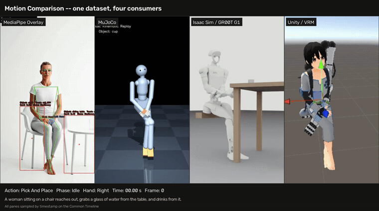

<div align="center">

# Common Behavior Data

**One behavior. Many bodies. Every gap measured.**

1つの行動を、多くの身体へ。そして**身体ごとのギャップを、数字で記録する。**

ふつうの動画を行動データ（CBD）に変え、それでモデルを学習し、ヒューマノイド・
ロボット・アバターで動かす —— そして**身体ごとに「その身体にできなかったこと」を、
その身体の単位の数字として記録する**ためのオープンな層です。

**GPU マシンは要りません。** パイプラインはターミナルから操作する Google Colab で動き
（ブラウザで開いた Codespace で十分）、VLA も同じやり方で Colab の GPU で学習します。
[3つのコマンドで始める →](#gpu-マシンが無くても動かせる--ターミナルから-colab-へ)

[](docs/limitations.md)
[](LICENSE)
[](adapters/README.md)
[](https://github.com/Koichi3333/vla-maker-from-cbd)
[](#協力者を募集しています--ギャップを測る)
[](#gpu-マシンが無くても動かせる--ターミナルから-colab-へ)

[](docs/media/CBD_Technical_Concept_Deck.pdf)

[English README](README.md) ·
**[VLA サンプル](#cbd-で学習した-vla)** ·
**[ギャップ](#ギャップ--このプロジェクトが測っているもの)** ·
**[GPU 無しで動かす](#gpu-マシンが無くても動かせる--ターミナルから-colab-へ)** ·
[Showcase](showcase/) ·
[Experiments](experiments/) ·
[コンセプト](docs/concept.md) ·
[ギャップ台帳](docs/compatibility_findings.md) ·
**[協力者募集](#協力者を募集しています--ギャップを測る)**


*左: ふつうの動画を CBD に変換したもの。右: CBD で学習した VLA に
「座った人がテーブルからグラスを取り、飲んで、元に戻す」と指示した結果。*

<sub>[vla-maker-from-cbd](https://github.com/Koichi3333/vla-maker-from-cbd) より。左の人物は学習データに含まれていません。
右は運動学の MuJoCo（姿勢を順に再生するだけで、力は計算していません）。指は無く、手が届いた時点でグラスが手に付きます。
グラスに届くまでは外部のプランナーが手を誘導し、口元へ持ち上げる動きはモデル自身のものです。
このシーンの 12 試行のうちの 1 つで、残り 11 試行ではグラスはあご以下の高さで止まります。</sub>

</div>

---

> **このページは日本語での概要です。**
> 正となるドキュメントは [English README](README.md) です。

---

## はじめての方へ

| やりたいこと | 行き先 |
|---|---|
| **CBD で学習した VLA を見る** | [下の節](#cbd-で学習した-vla) → [`vla-maker-from-cbd`](https://github.com/Koichi3333/vla-maker-from-cbd) |
| **いちばん大事な考え方を知る** | [ギャップ](#ギャップ--このプロジェクトが測っているもの) — data gap / body gap と、身体ごとの数字 |
| **1つの行動を4つの身体で見る** | [`showcase/`](showcase/) — 出力の映像をまず確認できます |
| **自分で動かす —— GPU マシン不要** | [動かし方](#gpu-マシンが無くても動かせる--ターミナルから-colab-へ) → [`colab-cli/`](colab-cli/) — Codespace でもノート PC でも、3つのコマンドから |
| **手伝う** | [協力者募集](#協力者を募集しています--ギャップを測る) — ほとんどが GPU 不要です |
| **ミニマムのサンプルを動かす** | [`examples/`](examples/) — Colab ノートブック2本 |

---

## CBD で学習した VLA

**[`vla-maker-from-cbd`](https://github.com/Koichi3333/vla-maker-from-cbd)** は、
CBD の上に実規模で作った最初の [experiment](experiments/) です。
VLA（vision-language-action モデル）は、カメラ画像と文章の指示を受け取って、
身体の動きを出力するモデルです。ここでは NVIDIA GR00T N1.7（3B）を CBD で
ファインチューニングしています。

```text
動画 / モーキャプ ──► CBD ──► VLA（GR00T N1.7） ──► CBD ──► Adapter ──► MuJoCo · Unitree G1 · VRM
                     └ このリポジトリ ┘ └ vla-maker-from-cbd ┘ └ このリポジトリ ┘
```

**モデルはロボットの関節角を出力しません。CBD を出力します** —— 19本の骨の回転と
腰の位置、1フレームあたり 117 個の数値です。それを MuJoCo のヒューマノイド・
Unitree G1・VRM アバターに載せるのは Adapter の仕事なので、
**身体ごとに学習し直す必要がありません。**

測った結果（学習に使っていないシーン、運動学の MuJoCo。数字はすべて
[results](https://github.com/Koichi3333/vla-maker-from-cbd/blob/main/docs/results.md) にあります）:

| | 結果 |
|---|---|
| 外部プランナーの誘導ありで、手が物に届く | **0.93**（VLM が選んだ目標）· 0.94（真の目標） |
| 同じく、モデル単独 | 0.51 —— 物の方へは向かうが、届くのは半分ほど |
| VLM が画像から指示された物を選ぶ | **378 / 378**（紛らわしい物があるシーンを含む） |
| 学習データに同じ文が無い指示 | `walks forward` で +3.06 m 前進 · `crawls on the floor` は 8 回中 6 回で四つん這い |
| 生成した歩行を CBD の Adapter で **Unitree G1** へ | 方向残差の中央値 **0.96°**（お手本の歩行は 1.54°） |

**まだ言えないこと:** 物理シミュレータや実機での成功（すべて運動学）、指での把持、
誘導なしでの正確な到達、動画の動きの予測で「今の姿勢を保つだけ」に勝つこと
（5.53° 対 5.05°）。コードは Apache-2.0、重みは非商用です（GR00T N1.7・AMASS・SMPL の条件による）。

**このループに手元の GPU はありません。** VLA の学習と評価は、Codespace から Colab CLI で
操作する Colab の A100 で行っており（このリポジトリと同じ道です —— [動かし方](#gpu-マシンが無くても動かせる--ターミナルから-colab-へ)）、
CPU のスモークテストはノート PC で動きます。

### 身体に依存しないモデルだからこそ、ギャップが資産になる

ある1台のロボット専用に学習したモデルは、そのロボットの限界を重みの中に隠します。
CBD を出力するモデルは、限界を表に出したままにします —— **身体ごとに、Adapter で、
数字として。** VLA は自分が G1 を動かしているのか VRM アバターを動かしているのかを
知りません。知っているのは Adapter で、Adapter が「この身体にはできなかった」と
報告するものが **body gap** です。規模（データ量・モデルサイズ）で買えるのは大きな
モデルです。**身体ごとのギャップの記録は買えません。**身体ごとに測るしかありません。

実際、VLA はこのリポジトリが記録してきたギャップにそのままぶつかりました:

- **代償を払って閉じた data gap。** CBD の動画 Generator は4本の骨（`chest`・`neck`・
  両 `shoulder`）を測れません。VLA は動画クリップで学習するために胴を SMPL（ROMP）で
  解いて埋めました —— ギャップは閉じましたが、SMPL の非商用・再配布不可の条件が
  学習データに入りました。
- **body gap。** G1 の腰（±30°）は、生成された動きが求める深い前屈に追従できません。
- **まだ開いている data gap。** 指の骨が無い（「持った」は手が物に近づいたかの判定）。
  移動の phase が無い（G1 Adapter は VLA の歩行で足を床に解けない）。
  そして「AMASS 由来の動きは再配布禁止」という条件を、`0.3.0` までは CBD のデータ自身が
  書く手段が無かった。

どれも [ギャップ台帳](docs/compatibility_findings.md) に1行ずつ記録されています。

---

## ギャップ —— このプロジェクトが測っているもの

このプロジェクトのいちばん有用な成果は、動画ではありません。行動が移植できなく
なった場所の一覧 —— **ギャップ台帳**
（[`docs/compatibility_findings.md`](docs/compatibility_findings.md)）です。

ギャップはすべて、次の**2種類**のどちらかです。**どちらなのかで、できることが決まります。**

```text
data gap（データのギャップ）   記録がそれを持っていない
                               → 上流で閉じられる：Generator の改善・センサー・
                                 スキーマへのチャネル追加

body gap（身体のギャップ）     2つの身体が本当に食い違っている
                               → 閉じられない：測って、移植先の単位で
                                 数字として公開するしかない
```

data gap は誰かのバグです。body gap は「脊椎を持たない 1.32 m のロボット」という事実です。
そして2つはつながっています。**data gap は、身体が変わった瞬間に body gap として現れます。**

<div align="center">


*1本のソース動画 → 1つの行動データセット → 同一タイムライン上の4つの身体。
4つの Adapter はコードを共有していません。画面同士が食い違うところが、ギャップです。*
</div>

### 身体ごとのギャップ

| 身体 | body gap（測った・閉じられない） | 露わになった data gap |
|---|---|---|
| **MediaPipe オーバーレイ** —— 元の映像そのもの | なし（カメラ自身の画面） | 見えない —— 測ったものを描くだけ |
| **MuJoCo ヒューマノイド** —— 被写体の寸法で作った身体 | 接触は解いていない（運動学の再生） | ほぼすべてを吸収 |
| **Unity / VRM 1.0** —— 誰も測っていない任意のアバター | 見つからず（T ポーズ基準のリターゲットは無償） | ほぼすべてを吸収 |
| **Unitree G1** —— Isaac Sim、43 自由度、1.32 m | 動きはコピーではなく**解く**：平均残差 **6.87°** · 家具の方を縮める **`scale = 0.685`** · 両足首ピッチが **96 / 96** フレーム限界（リターゲット段） · 首が無い · 指は片手3本 | 回転の無い4本の骨 → 画像のグラス位置と手の位置が **0.296 m** ずれる · 支持関係が無い → 椅子ではなく 110 mm の台 · `phase` が **96 / 96** フレーム `Idle` · 力・接触が無い |
| **VLA が動かす G1** —— 生成された動き | 腰 **±30°** で深い前屈が切れる · 歩行の方向残差 中央値 **0.96°** | 移動の phase が無い → 足が床に解かれない · 指の骨が無い |

人の形をした身体は、ほぼすべてを吸収しました。**機械はそうではなかった**。だから
やる価値がありました。ロボットの方を伸ばせば、それはハードウェアについての捏造です。
だからギャップをそのまま公開しています。

**新しい身体は、この表の新しい1行です。** それこそが、このプロジェクトが積み上げていく
貢献です —— [協力者募集](#協力者を募集しています--ギャップを測る)へ。

### データ自身もギャップを申告する

長いあいだ、データはこのことを何も語りませんでした。回転しない4本の骨は静止した胴に
見え、96 フレームの `Idle` は何も起きなかったクリップに見え、`quality.json` は物の
3D 位置が 173 件中 1 件しか無いクリップで `object_coverage: 1.0` と報告していました。

**データ版 `0.3.0` から、データは自分の data gap を申告します。** 各チャネルが
`measured` / `derived` / `estimated` / `prior` / `degenerate`（書かれているが情報が無い）/
`absent`（存在しない）のいずれかを `manifest.json` と `quality/channel_provenance.json` に
書き、判定は決め打ちではなく系列を測って行います。body gap は「(この行動, この身体)」の
組の性質なので、データではなく各 Adapter のレポートに `asked` / `got` / `error` /
`tolerance` として書かれます。

まだ開いていることも書いておきます。**この申告を読む Adapter はまだありません。**
また G1 Adapter 自身の台帳は、出力の約 30 % しか採点していないのに全体の合格を出して
います —— 自分たちの計測器のギャップです。

---

## 協力者を募集しています —— ギャップを測る

**今のところ一人で作っているプロジェクトで、仲間を必要としています。** 下の項目は
どれも単独で取り組めて、ほとんどは GPU もこのリポジトリの経緯の知識も要りません。
各項目に Issue があります。重複を避けるため、取り組む前に Issue にコメントしてください。
一覧に無いアイデアは [Discussion](https://github.com/Koichi3333/common-behavior-data/discussions) へどうぞ（Issue は英語で書いていますが、日本語のコメントも歓迎です）。

| | やること | 閉じる・測るギャップ | GPU |
|---|---|---|---|
| 🟢 | [#1](https://github.com/Koichi3333/common-behavior-data/issues/1) **新しい身体を持ち込む。** [サンプル](examples/human-capture/sample_output/04_behavior_dataset/)を、まだ無いターゲット（MuJoCo Menagerie のロボット・SO-101 アーム・Blender・Godot・ROS 2 など）に読み込み、[ギャップ報告](https://github.com/Koichi3333/common-behavior-data/issues/new?template=portability_finding.md)を出す | [身体ごとのギャップ](#身体ごとのギャップ)の新しい1行 | 不要 |
| 🟢 | [#2](https://github.com/Koichi3333/common-behavior-data/issues/2) **物を扱う場面を撮影して CBD として提供する。** 座って・立って、固定カメラで。[動画 Generator](generators/video_to_cbd/) で変換 | VLA に最も足りないのはデータ。自分の持つデータだけが商用利用できるモデルにつながる | 不要 |
| 🟠 | [#3](https://github.com/Koichi3333/common-behavior-data/issues/3) **`0.3.0` の申告を読む最初の Adapter を作る。** G1 Adapter の [`phases.py`](adapters/isaac_sim_groot_g1/phases.py) が申告を信じ、自前の検定は予備に回す | 「申告した data gap」を契約にする | 不要 |
| 🟠 | [#4](https://github.com/Koichi3333/common-behavior-data/issues/4) **検証ツールを書く** ——「このバンドルは書き出す全チャネルに tier を申告しているか」を [`tools/`](tools/) に | data gap を検査可能にする | 不要 |
| 🔴 | [#5](https://github.com/Koichi3333/common-behavior-data/issues/5) **胴の4本の骨に回転を与える** —— `chest`・`neck`・両 `shoulder` | 最大の data gap。G1 で 0.296 m、VLA が SMPL を持ち込んだ理由 | 不要 |
| 🟡 | [#6](https://github.com/Koichi3333/common-behavior-data/issues/6) **移動の phase を作る**（VLA の歩行を G1 Adapter が床に置けるように） | data gap → body gap | 不要 |
| 🟡 | [#7](https://github.com/Koichi3333/common-behavior-data/issues/7) **指の骨の回転** —— G1 と VLA、2つの利用者が同じものを求めている | data gap | 不要 |
| 🟡 | [#8](https://github.com/Koichi3333/common-behavior-data/issues/8) **G1 の台帳が、採点したものを覆うようにする**（今は約 30 %） | 計測器のギャップ | 不要 |
| 🔵 | **VLA 側の課題** —— 誘導なしの到達・物理での確認・Colab 以外の GPU・CI | [`vla-maker-from-cbd` #1〜#8](https://github.com/Koichi3333/vla-maker-from-cbd#help-wanted) | 一部 |

> **行動をひとつ選ぶ → 新しい身体で動かす → どこにギャップがあったか教えてください。**

いちばん手早い貢献は 30 分ほどでできます。サンプルを取り、このプロジェクトが聞いた
こともないシステムに読み込もうとして、足りなかったものを報告する。数字の付いた
ギャップは、数字の無い報告の何倍も価値があります。うまくいったデモより、記録された
失敗のほうが価値があります。

詳細は [`CONTRIBUTING.md`](CONTRIBUTING.md) をご覧ください。接続したいロボット・
シミュレータ・モデル・アプリケーションがある方、スキーマの判断が間違っていると思う方は、
ぜひ [Discussion](https://github.com/Koichi3333/common-behavior-data/discussions) へ。
それが今このプロジェクトが受け取れる、いちばん役に立つフィードバックです。

---

## GPU マシンが無くても動かせる —— ターミナルから Colab へ

**このリポジトリを動かすのに、GPU も CUDA のインストールもクラウドのプロジェクトも
要りません。** 必要なのは Google アカウントとターミナルだけで、ターミナルはブラウザで
開いた GitHub Codespace で十分です。ノートブックは Google Colab の VM 上で動き、その VM の
起動・実行・停止をターミナルから公式の [Colab CLI](https://github.com/googlecolab/google-colab-cli)
で行います。GPU が必要なときはそのセッションだけ Colab の GPU を借り、終わったら返します。

```text
手元のターミナル（Codespace・ノート PC・SSH）        Google Colab の VM
  colab-cli/setup.sh     最初に1回
  colab-cli/auth.sh      最初に1回  ──────────►  Google アカウントでログイン
  colab new --gpu T4                ──────────►  CPU · T4 · A100  ← GPU は Colab のもの
  colab exec -f X.ipynb             ──────────►  ノートブックを画面なしで実行
  colab download                    ◄──────────  結果をファイルで受け取る
  colab stop                        ──────────►  VM を解放
```

**VLA まで同じ道でつながっています。** [`vla-maker-from-cbd`](https://github.com/Koichi3333/vla-maker-from-cbd)
も 3B のモデルを同じやり方で学習・評価しています —— Codespace から操作する Colab の A100 です。
つまり上の GIF のループ全体（動画 → CBD → VLA → CBD → 身体）が、自分の GPU 無しで回ります。

| 工程 | 動かす場所 | GPU |
|---|---|---|
| [`generators/video_to_cbd/`](generators/video_to_cbd/) | Colab（CLI から） | T4 があると速い。CPU でも完走 |
| [`adapters/mediapipe_overlay/`](adapters/mediapipe_overlay/)・[`mujoco/`](adapters/mujoco/) | Colab（同じセッション） | 不要 —— MuJoCo は T4 なら EGL、CPU なら OSMesa で描画 |
| [`adapters/unity_vrm/`](adapters/unity_vrm/) | Colab がファイルを書き、Unity が手元で再生 | 不要 |
| [`adapters/isaac_sim_groot_g1/`](adapters/isaac_sim_groot_g1/) —— リターゲット・合成 | どのマシンでも（素の Python） | 不要 |
| [`adapters/isaac_sim_groot_g1/`](adapters/isaac_sim_groot_g1/) —— **描画・PhysX** | **唯一の例外:** Google Compute Engine · `g2-standard-16` · NVIDIA L4 × 1 · Isaac Sim 6.0 —— 出力はコミット済み | 必要 |
| [`vla-maker-from-cbd`](https://github.com/Koichi3333/vla-maker-from-cbd) —— スモークテスト | ノート PC の CPU | 不要 |
| [`vla-maker-from-cbd`](https://github.com/Koichi3333/vla-maker-from-cbd) —— 推論・学習 | Colab A100（CLI から）· 目標ファイル1つあたり約 1.4 コンピューティング ユニット、5,000 ステップの学習で約 9 | 必要 |

このリポジトリのノートブックは、どれも無料の Colab の CPU で動きます。無料枠の T4 は
空いていれば使えますが、保証はありません。A100 には有料の Colab プランが必要です。

### まずはここから: [`colab-cli/`](colab-cli/)

必要なものは1つのディレクトリにまとまっています。リポジトリのルートで:

```bash
colab-cli/setup.sh        # uv と google-colab-cli 0.7.5 を入れる（何度流してもよい）
colab-cli/auth.sh         # ログイン。マシンごとに1回。ブラウザでページが開く
colab-cli/smoke_test.sh   # CPU の VM を起動 → 実行 → ファイル回収 → 停止（約1分）
```

続けて本線 —— リポジトリに同梱のサンプル動画で、Generator → Adapter を**1つのセッションで**:

```bash
cd colab-cli/ws && R=../..                                  # 作業はここで（gitignore 済み）
cp $R/generators/video_to_cbd/cbd_generator_video_to_cbd.ipynb \
   $R/adapters/mujoco/cbd_adapter_mujoco.ipynb .            # コピーする: 出力は入力の隣に書かれる
colab new -s cbd                                            # GPU を使うなら --gpu T4
python3 ../tools/colab_secrets.py -s cbd GEMINI_API_KEY     # 任意。キーを colab exec に書かない
colab upload -s cbd $R/examples/human-capture/sample_output/source/source_video.mp4 \
                    /content/source_video.mp4
colab exec   -s cbd -f cbd_generator_video_to_cbd.ipynb --timeout 1800 2>&1 | tee generator.log
colab exec   -s cbd -f cbd_adapter_mujoco.ipynb         --timeout 1800 2>&1 | tee mujoco.log
grep -nE "^(Traceback|[A-Za-z]*Error:)" *.log               # セルが失敗しても終了コードは 0
colab download -s cbd /content/human_behavior_demo_2_0/cbd_dataset.zip ./cbd_dataset.zip
colab stop -s cbd && colab sessions                         # 必ず止めて、確認する
```

| 次に知りたいこと | 読むところ |
|---|---|
| Codespace と自分のマシンで何が違うか | [クラウドとローカルで違うところ](colab-cli/README.ja.md#クラウドとローカルで違うところ) —— ログイン・キー・Rebuild で消えるもの |
| 他の Adapter を流したい / どのノートブックが画面なしで動くか | [このリポジトリのノートブックを流す](colab-cli/README.ja.md#このリポジトリのノートブックを流す) |
| 落とし穴を避けたい —— VM の止め忘れ、既定 30 秒のタイムアウト、終了コード | [守ること5つ](colab-cli/README.ja.md#守ること5つ) |
| ブラウザ無しで `input()`・ファイルアップロード・Google Drive を使いたい | [フィールドガイド](colab-cli/guide/field_guide.ja.md#対話コードinput-などの扱い) |
| Claude Code に操作させたい | [`colab-cli/CLAUDE.md`](colab-cli/CLAUDE.md) —— [`.claude/settings.json`](.claude/settings.json) のフックが、止め忘れたセッションを警告します |

実際にこの方法で動かしたもの: Codespace 上の `google-colab-cli` 0.7.5 で、ログイン →
スモークテスト → Generator → MuJoCo Adapter を CPU ランタイムで最後まで（2026-11-07）。
**GPU ランタイムと残り2つのノートブック Adapter は、0.7.5 ではまだ確認していません。**
ローカルマシンでも未確認です。VLA の A100 での実行は、今は独自のスクリプトと古い CLI（0.6.x）
によるもので、同じ `colab-cli/` の構成へ揃える予定です。詳細:
[`colab-cli/README.ja.md`](colab-cli/README.ja.md#状態--何を動かし何をまだ動かしていないか)

**唯一の例外は Isaac Sim です。** Colab が出さない RTX GPU、数十 GB のコンテナ、実行を
またいで残るシェーダーキャッシュが要るため、Colab には収まりません。その README の冒頭に
マシンを明記し、**出力はコミット済み**なので、GPU に触れなくても結果を読めます。
新しいターゲットのルール: [`docs/runtime_environments.md`](docs/runtime_environments.md)

---

## CBD とは何か

行動をデジタル活用する場合は、通常、**特定のツールの中へ**取り込まれます —— モーション
キャプチャ形式、ゲームエンジンのクリップ、シミュレータの軌道、データセットスキーマ、
あるロボットの関節構成などです。ツールが変われば、パイプラインを作り直す必要が生じます。

CBD は、その中間に再利用可能な層を1つ置き、**観測そのものを資産に変えます**。

```text
映像 / 画面録画 / センサー / その他の観測
        ↓
   Generator（行動抽出）         ← 差し替え可能
        ↓
   Canonical CBD                 ← 資産
        ↓
   身体ごとの Adapter            ← 差し替え可能
        ↓
   MuJoCo · Unity · Isaac Sim · ロボット · ML データセット · VLA
        ↓
   ギャップ                      ← この身体にできなかったこと、どれだけか
        ↓
   ギャップ台帳 → Generator / Adapter / 仕様の改善
```

データソースとして映像を最も重視しています。理由は、**最も精度が高いから**ではなく、
**誰でも作成出来るから**です。センサーは映像の対極にあるわけではなく、映像が苦手な部分
—— スケール、Ground Truth、そして接触・力・トルクのように映像がまったく見られない量 ——
を補うものとして利用していく予定です。

CBD は **人体モーション専用ではありません。** *観測 → 行動 → 再利用* という構造自体は、
PC 作業画面のスクリーンキャプチャなど様々なものに応用可能であると考えています。
詳細: [`docs/behavior_asset.md`](docs/behavior_asset.md)

`timeline/frames.jsonl` の **1行は1フレームで、1フレームは画像・言語・動き・物・状態の
完全な組**です。だから VLA は、間にアノテーション作業を挟まずに学習できます。

---

## リポジトリの構成

| ディレクトリ | 役割 | 状態 |
|---|---|---|
| [`generators/`](generators/) | **CBD を作る** | 動画 → CBD、動作中 |
| [`adapters/`](adapters/) | **CBD を身体で使う** —— そしてギャップを報告する | 4 ターゲット、動作中 |
| [`experiments/`](experiments/) | **CBD で何かを試す** | **VLA**（[別リポジトリ](https://github.com/Koichi3333/vla-maker-from-cbd)）· 追加歓迎 |
| [`showcase/`](showcase/) | **CBD で何ができるかを見る** | 4 つの結果 |
| [`examples/`](examples/) | **最初の最小体験** | 当時のまま保存、実行可能 |
| [`tools/`](tools/) | **資産の準備と加工** | ほぼ空 —— 検証ツールを募集中 |
| [`colab-cli/`](colab-cli/) | **ターミナルから Colab でノートブックを動かす** | セットアップ・ログイン・疎通確認・キー —— [動かし方](#gpu-マシンが無くても動かせる--ターミナルから-colab-へ) |
| [`specification/`](specification/README.md) | **Canonical CBD の定義** | 実験的、Adapter 主導 |
| [`docs/`](docs/) | **設計と考え方の説明** —— [ギャップ台帳](docs/compatibility_findings.md)を含む | — |

Adapter はわざと互いにコードを共有しません（物理の前提も身体の構造も違うため）。
Adapter の間を行き来するのはコードではなく、**書き留められたギャップ**です。

---

## 限界

このリポジトリは**実験段階**です。単一人物・単眼推定のキャプチャであり、MuJoCo 再生は
運動学の再生、G1 Adapter は**ポリシーを実行していません**。VLA の評価は**運動学のみ**で、
正確な到達には外部の誘導が必要で、重みは非商用です。Sim-to-real の主張も、ロボットの
タスク成功の主張もありません。スキーマは随時、変更されます。

`0.3.0` から、データは自分のどのチャネルが実測だったかを申告します。ただし
**申告してもギャップは埋まりません** —— 4本の骨と `phase` は「書かれているのに情報を
持たない」状態のままで、`degenerate` という印が付いただけです。読む側の Adapter も
まだありません。また、**同梱のサンプル出力は `0.2.0`** で、これらのフィールドを含みません。

理由付きの全リスト: [`docs/limitations.md`](docs/limitations.md)

## ライセンスと第三者素材

本リポジトリのオリジナルのソースコードとドキュメントは、特記なき限り
**Apache-2.0**（[`LICENSE`](LICENSE)）です。

データセット、モデル重み、デモ用メディア、ソース動画、VRM アセット、ロボット
アセット、その他の第三者素材は別のライセンス条件を持つ場合があります
（`examples/*/sample_output/` のサンプル出力を含む）。再配布の前に
[`THIRD_PARTY_NOTICES.md`](THIRD_PARTY_NOTICES.md) をご確認ください。
VLA の重みと学習データには、[そのリポジトリ](https://github.com/Koichi3333/vla-maker-from-cbd#license)に
記載された非商用の条件があります。
