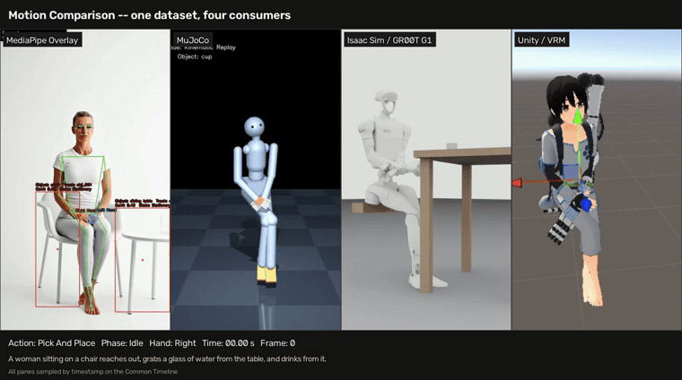
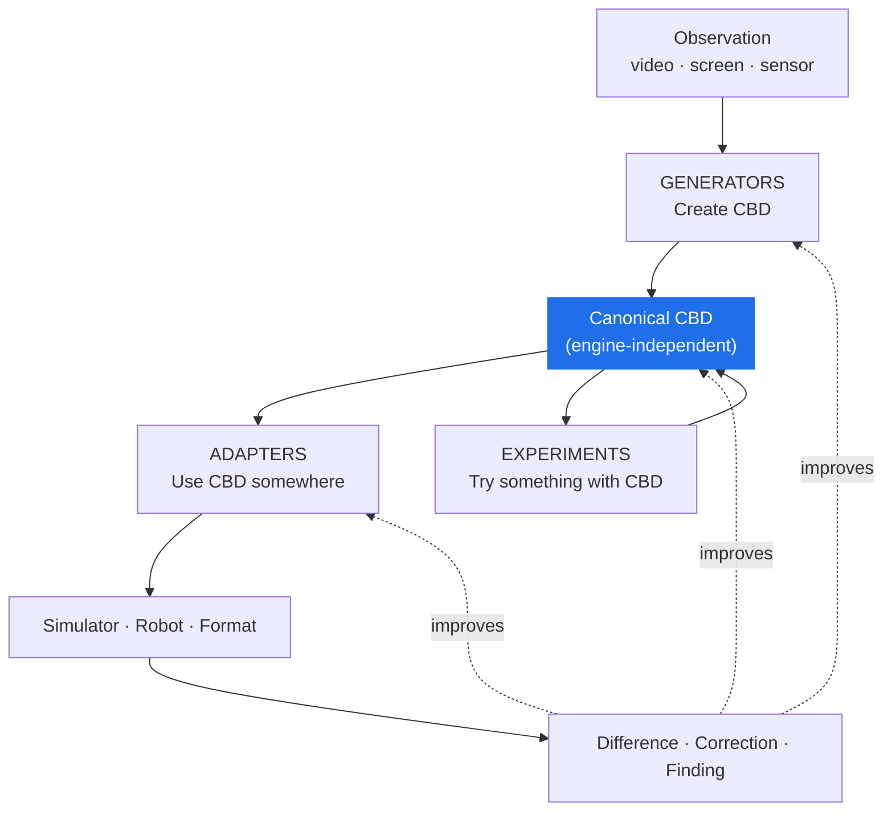

<div align="center">

# Common Behavior Data

**Behavior should be portable.**

An open framework for turning observed behavior into reusable assets across
simulators, robots, models, and tools.

*Generate behavior once, adapt it to different environments, measure what
breaks, and keep improving portability.*

[](docs/limitations.md)
[](LICENSE)
[](adapters/README.md)

[](docs/media/technical-concept-deck.pdf)

*The whole idea — concept, architecture, demos, and roadmap — in one visual overview.*

[日本語 README](README.ja.md) ·
**[Showcase](showcase/)** ·
[Concept](docs/concept.md) ·
[Architecture](docs/architecture.md) ·
[Specification](specification/README.md) ·
[Roadmap](docs/roadmap.md) ·
[Limitations](docs/limitations.md)



*One source video → one behavior dataset → four different targets, same timeline.*

</div>

---

## New here? Three minutes

| If you want to… | Go to |
|---|---|
| **See what it does** | [`showcase/`](showcase/) — videos first, code later |
| **Understand the idea** | [How CBD works](#how-cbd-works), below |
| **Run the smallest complete example** | [`examples/`](examples/) — two Colab notebooks |
| **Run the current pipeline** | [`generators/`](generators/) → [`adapters/`](adapters/) |
| **Read the data format** | [`specification/`](specification/README.md) |
| **Help** | [How you can contribute](#how-you-can-contribute) |

---

## Turn observations into reusable behavior assets

Behavior is normally captured *into* a tool: a motion capture format, a game
engine's clip, a simulator's trajectory, a dataset schema, a model's output
head, one robot's joint layout. The recording is worth about as much as the tool
that holds it. The next tool means rebuilding the pipeline; the next model means
recapturing.

CBD puts one reusable layer in the middle, and treats the observation itself as
the asset:

```text
Video / Screen capture / Sensor / Other observation
        ↓
   Behavior extraction        ← replaceable
        ↓
   Canonical CBD              ← the asset
        ↓
   Adapter per target         ← replaceable
        ↓
   MuJoCo · Unity · Isaac Sim · Robot · ML dataset
```

> **Video can be treated as a reusable behavior asset rather than a one-time
> input.** The same idea extends to screen recordings, sensor-assisted
> observations, and other sources of behavior.

Video is emphasised because it is the most **available** observation, not the
most accurate: footage already exists, needs no capture rig, can be re-analysed
years later by a better model, and works in places where a specialised sensor
will never be installed.

**Sensors are not the opposite of this.** They complement video exactly where it
is weak — calibration, scale, ground truth, validation, and the physical
quantities video cannot see at all: contact, force, torque, tactile, IMU.

CBD is also **not limited to human body motion**. Today's pipeline extracts it,
and that is where the evidence is, but nothing in *observation → behavior →
reuse* requires a skeleton. Hand and object manipulation, robot demonstrations,
work procedures, screen recordings and UI interaction are all the same shape.
Screen behavior is not specified, not implemented, and deliberately has no empty
directory — it is a [direction](docs/behavior_asset.md#not-only-human-body-motion),
and a reason not to build human-skeleton assumptions into the structure.

More: [`docs/behavior_asset.md`](docs/behavior_asset.md).

---

## Showcase — what actually ran

**[→ showcase/](showcase/)** — the results in video form, each with an honest
note on what worked and what broke.

| | Target | The interesting part |
|---|---|---|
| [Video → MuJoCo](showcase/video_to_mujoco/) | MuJoCo humanoid | model and motion stay separate; kinematic replay, no physics claimed |
| [Video → Unity / VRM](showcase/video_to_unity/) | any VRM 1.0 avatar | drives an avatar **nobody measured** |
| [Video → Isaac Sim / G1](showcase/video_to_isaac_g1/) | **Unitree G1 as GR00T drives it** | a machine whose proportions are not negotiable — and the costs, as numbers |
| [Cross-simulator](showcase/cross_simulator/) | all four at once | four adapters, zero shared code, one timeline |

The four adapters share no code and never read each other's output. The only
thing they have in common is `04_behavior_dataset/`. If the panes agree, the
agreement is a property of the representation.

---

## How CBD works

```text
Video
  ↓
Generator                 generators/    Create CBD
  ↓
Canonical CBD             specification/ engine-independent, one timeline
  ↓
Adapter                   adapters/      Use CBD somewhere
  ↓
Target environment                       MuJoCo · Unity · Isaac Sim · Robot
  ↓
Validation / Difference                  what worked, what broke, by how much
  ↓
Finding                   docs/compatibility_findings.md
  ↓
Generator / Adapter / Specification improvement
```

The loop at the bottom is the part that matters most, and it is why this
repository keeps failures. What one target teaches gets carried to the others —
**as knowledge, not as shared code**.



### One line is one complete sample

`timeline/frames.jsonl` is the file that carries the idea. **One line is one
frame, and one frame is a complete tuple:**

```jsonc
{
  "frame": 42,
  "timestamp_sec": 3.5,
  "frame_image": "timeline/frames/000042.jpg",                                    // vision
  "caption": { "en": "The person reaches for the cup", "source": "gemini_api" },  // language
  "human": {
    "bone_rotations_xyzw": { "left_upper_arm": [0, 0, 0, 1] },                    // motion
    "hips_position": [0, 0, 0],
    "finger_curls_rad": {}, "joint_angles_deg": {}, "gestures": {}
  },
  "objects": [ { "track_id": "obj_005", "label": "cup", "role": "target",
                 "position_source": "estimated_from_hand" } ],                    // objects
  "interactions": [ { "type": "grasp_candidate", "score": 0.8 } ],                // candidates
  "phase": { "action": "Pick And Place", "phase": "Grasp", "hand": "Right" }      // state
}
```

Vision + language + motion + objects + phase, aligned on one clock. Supervision
is complete at the frame level, so no annotation pass sits between capture and
training. The same data is also projected into column-oriented CSVs for analysis
and for adapters that need one series.

Three conventions that change how it should be read:

- **`interaction_events` are candidates**, not ground truth. The names say so,
  and no adapter may promote them.
- **Derived 3D positions carry `position_source`** — depth that was inferred
  rather than measured is always marked.
- **Captions are AI-generated**, recorded with the model that produced them.

Full description: [`specification/README.md`](specification/README.md).

---

## Repository structure

| Directory | Role | State |
|---|---|---|
| [`generators/`](generators/) | **Create CBD** | video → CBD, working |
| [`adapters/`](adapters/) | **Use CBD somewhere** | 4 targets, working |
| [`tools/`](tools/) | **Prepare and manipulate assets** | mostly empty |
| [`experiments/`](experiments/) | **Try something with CBD** | placeholder |
| [`examples/`](examples/) | **Initial Minimum Experience** | preserved, runnable |
| [`showcase/`](showcase/) | **See what CBD can do** | 4 results |
| [`specification/`](specification/README.md) | **Define Canonical CBD** | experimental, adapter-driven |
| [`docs/`](docs/) | **Explain the architecture and philosophy** | — |

Each has its own README that starts with *what is this, what goes here, input,
output, minimal example*.

Two structural rules worth knowing before you read code:

- **Adapters are self-contained, not DRY.** Retarget, contact, physics,
  placement, validation and reporting live inside the adapter that needs them,
  even when two adapters look similar. Simulator physics and robot bodies differ
  enough that a shared helper becomes quietly wrong for each. See
  [why](adapters/README.md#self-contained-beats-dry).
- **`tools/` is not a place to hide shared adapter logic.** It holds independent
  utilities — video prep, masking, asset creation, comparison, dataset
  inspection — that are useful on their own.

What travels between adapters is the **finding**, not the code:
[`docs/compatibility_findings.md`](docs/compatibility_findings.md).

---

## Where things run

*Colab CLI where the target allows it; a documented machine where it does not.*

| Step | Environment |
|---|---|
| [`generators/video_to_cbd/`](generators/video_to_cbd/) | Google Colab — **CLI recommended** |
| [`adapters/mediapipe_overlay/`](adapters/mediapipe_overlay/), [`mujoco/`](adapters/mujoco/) | Google Colab — CLI, same session |
| [`adapters/unity_vrm/`](adapters/unity_vrm/) | Colab writes the files; Unity plays them locally |
| [`adapters/isaac_sim_groot_g1/`](adapters/isaac_sim_groot_g1/) — retarget, compose | any machine, plain Python |
| [`adapters/isaac_sim_groot_g1/`](adapters/isaac_sim_groot_g1/) — **render, PhysX** | **Google Compute Engine · `g2-standard-16` · 1 × NVIDIA L4** · Isaac Sim 6.0 |

Isaac Sim is the one exception, because it cannot run in Colab: it needs an RTX
GPU the runtime does not expose, a container measured in tens of gigabytes, and
a shader cache that survives between runs. Its README states the machine at the
top, and **its outputs are committed**, so the result is readable by someone who
never touches a GPU. Anything new that *can* run in Colab, should.

Rules for new targets: [`docs/runtime_environments.md`](docs/runtime_environments.md).

### Running the current pipeline

```bash
colab new -s cbd
colab upload -s cbd ./source_video.mp4 /content/source_video.mp4
colab exec   -s cbd -f cbd_generator_video_to_cbd.ipynb        --timeout 1800
colab exec   -s cbd -f cbd_adapter_mediapipe_overlay.ipynb     --timeout 1800
colab exec   -s cbd -f cbd_adapter_mujoco.ipynb                --timeout 1800
colab exec   -s cbd -f cbd_adapter_unity_vrm.ipynb             --timeout 900
colab download -s cbd \
  /content/human_behavior_demo_2_0/cbd_dataset.zip ./cbd_dataset.zip
colab stop -s cbd
```

`cbd_dataset.zip` is the **only** thing passed between them — the generator
knows nothing about MuJoCo or VRM, and each adapter reads canonical CBD and
nothing else. The G1 adapter takes the same zip directly:

```bash
python adapters/isaac_sim_groot_g1/cbd_adapter_groot_g1.py --dataset ./cbd_dataset.zip
```

Details: [`generators/README.md`](generators/README.md) ·
[`adapters/README.md`](adapters/README.md).

---

## Initial Minimum Experience

> The original examples are preserved as the smallest end-to-end demonstrations
> of the Common Behavior Data concept.

[`examples/`](examples/) holds the two notebooks the project started from,
**kept as they are**. They run top to bottom in a fresh Colab runtime with no
local setup, and their outputs are committed.

| Demo | Direction | |
|---|---|---|
| [A — Human Capture](examples/human-capture/) | video → CBD → MuJoCo / Unity | [](https://colab.research.google.com/github/Koichi3333/common-behavior-data/blob/main/examples/human-capture/human_behavior_demo_2_0.ipynb) |
| [B — Language to Motion](examples/language-to-motion/) | CBD → learning → generated CBD | [](https://colab.research.google.com/github/Koichi3333/common-behavior-data/blob/main/examples/language-to-motion/human_behavior_vla_trainer.ipynb) |

They are not being modernised into the current layout — rewriting them would
destroy what they are useful for. They are the project's origin, its first
architecture, and the baseline every later adapter is compared against.

> ⚠️ **Demo B is not a general-purpose VLA.** At this scale it is a small
> VLA-like learning prototype that demonstrates memorisation, interpolation and
> language-conditioned generation. It does not generalise to unseen
> instructions.

**Examples vs. Showcase vs. Experiments:** examples answer *how did the initial
CBD experience work*, showcase answers *what can CBD do*, experiments answer
*what happens if we try this*.

---

## Current adapters

| Adapter / connection | Status | Evidence |
|---|---|---|
| Video → CBD | **Available** | [`generators/video_to_cbd/`](generators/video_to_cbd/) |
| CBD → MediaPipe overlay | **Available** | [`adapters/mediapipe_overlay/`](adapters/mediapipe_overlay/) — redrawn from the dataset |
| CBD → MuJoCo humanoid | **Available** | [`adapters/mujoco/`](adapters/mujoco/) — kinematic replay (`qpos` + `mj_forward`) |
| CBD → Unity / VRM | **Available** | [`adapters/unity_vrm/`](adapters/unity_vrm/) — VRMA export, UniVRM SimpleVrma playback |
| CBD → Isaac Sim / GR00T, Unitree G1 | **Available** | [`adapters/isaac_sim_groot_g1/`](adapters/isaac_sim_groot_g1/) — 43-DoF retarget under the URDF's limits, USD stage, PhysX pass, GR00T-LeRobot dataset. No policy is run |
| CBD → behavior dataset | **Available** | `frames.jsonl` + CSVs |
| Language → CBD | **Experimental** | Demo B, small learning prototype |
| CBD → other robot embodiments (e.g. SO-101) | Planned | target platform not yet fixed |
| CBD ↔ LeRobot · ROS 2 | Planned | integration / contributor target |

Nothing marked *Planned* exists as code here — see [`docs/roadmap.md`](docs/roadmap.md).

---

## Experiments

[`experiments/`](experiments/) is where a question gets asked **using the pieces
that already exist**:

```text
Existing video → existing generator → CBD dataset
                                        ↓
                                   the new thing
                                        ↓
                            generated / predicted CBD
                                        ↓
                       existing adapter → simulator → evaluation
```

Only the middle box is new. Nothing stable may import from `experiments/`, which
is what makes an experiment safe to delete — and an experiment is promoted to a
generator, adapter or tool only after repeated success, a clear interface, and
use outside the experiment itself.

Today the learning work still lives in the Demo B notebook; moving it here is a
pending step.

---

## What we are learning

The most useful output of this project so far is not a video. It is the list of
places where behavior stopped being portable — collected, with numbers, in
[`docs/compatibility_findings.md`](docs/compatibility_findings.md).

The human-shaped targets absorbed almost everything. **The machine did not**,
and that is what made it worth doing:

- **Four bones carry no rotation.** `chest`, `neck` and both shoulders are
  identity in every frame, so a G1's waist can only yaw — and a reach to the
  subject's side comes out as a reach to the robot's front. Largest remaining
  error in the output, and now the binding constraint.
- **Canonical space declares no real scale.** Unstated is one thing; it becomes
  load-bearing the moment a 1.32 m robot has to sit on furniture derived from a
  taller subject.
- **Nothing states what the subject rests on.** A support relation had to be
  solved from the retargeted pelvis.
- **`phase` can be degenerate with no way to know.** All 96 frames of a
  pick-and-place clip read `Idle`.
- **Force and contact are missing entirely.** That is what stands between a
  joint-space replay and a dynamically feasible trajectory — the adapter writes
  a dataset a policy could train on and cannot say whether the robot could hold
  the pose.

And some corrections worth borrowing, as ideas rather than code: solve a sole as
a **contact polygon, not a point** (penetration 0.118 m → 0.000 m; the
single-point check was reporting a pass with the toes 87 mm underground);
**publish what the physics returned**, not what you asked for; **interpolate
dropouts** instead of holding the nearest value.

None of this required changing the representation. All of it is a request to
improve it.

---

## How you can contribute

Not "contributions are welcome" — here is what would actually help:

- **Add an adapter** for another simulator, engine, or robot
- **Build a new generator** — a different video → CBD pipeline, or a new source
- **Test existing CBD on a new embodiment** and report where it fails
- **Report where behavior portability breaks** — with a number attached
- **Improve an existing adapter's physical correction**
- **Add a video asset or a behavior case** the current pipeline handles badly
- **Build a video / asset preparation tool** — masking, anonymisation, comparison
- **Use the existing generator and adapters in an ML experiment**
- **Explore screen-recorded behavior** and other non-body workflows

> **Pick a behavior. Run it somewhere new. Tell us what breaks.**

The cycle this repository is built around:

```text
Try → Find difference → Measure → Correct → Document → Contribute
```

A finding with a number attached is worth several without one, and a failure you
documented is worth more than a demo that worked.

Start with [`CONTRIBUTING.md`](CONTRIBUTING.md). Open an issue or a discussion
before large design changes — the schema is still moving, and it should move
because of a real integration rather than in the abstract.

**Using CBD, or want to?** Have a robot, simulator, model or application you
would like to connect? Want an adapter that does not exist yet? Open a
[Discussion](https://github.com/Koichi3333/common-behavior-data/discussions) or
an [Issue](https://github.com/Koichi3333/common-behavior-data/issues). Feedback
that a schema decision is wrong is the most useful thing this project can
receive right now.

---

## Roadmap

The next question is not more human capture. It is whether the abstraction
**survives more changes of embodiment** — and the G1 run says it survives one,
at a cost it can now name.

Three directions, in order of how much they would change things:

1. **Whole-body reach.** Rotation for the four bones that carry none is now the
   binding constraint on the robot target, and it is a specification question
   before it is an adapter one.
2. **Force and contact channels.** Whether they belong on the same timeline as
   first-class channels or in a layer joined by timestamp is open — and best
   answered with a real sensor integration rather than in the abstract.
3. **More targets, deliberately unlike the ones we have.** Another robot
   embodiment, another simulator. A target similar to an existing one teaches
   almost nothing; the G1 taught a great deal precisely because it was not a
   human-shaped figure.

Full plan: [`docs/roadmap.md`](docs/roadmap.md).

## Limitations

The short version:

- Single-person capture; depth is monocular estimation
- Interaction detection is heuristic **candidates**, not ground truth
- MuJoCo playback is **kinematic replay**, not physically correct contact
- The G1 adapter runs **no policy**; it writes a dataset one could be trained on
- The learning prototype memorises and interpolates; it does not generalise
- No sim-to-real, no robot task success, no grasp correctness claim
- Finger angles are approximations from hand landmark curl
- The schema is unstable and will change

Full list with reasoning: [`docs/limitations.md`](docs/limitations.md).

## Why open?

Large organisations will win on dataset scale, model size, dedicated hardware,
and vertically integrated robot stacks. This project is not competing there.

The hypothesis it *is* testing is that there is durable value in the opposite
properties: neutrality, interoperability, open specifications, reusable behavior
semantics, and adapter-based integration — a layer that belongs to nobody in
particular, and is therefore usable by everybody.

The long-term goal is not a video-conversion repository and not a human-motion
repository. It is:

> **A growing collection of reusable behavior assets, adapters, experiments, and
> portability findings.**

That is the design goal, stated as a goal. It is not traction, and this
repository will not pretend otherwise. More in
[`docs/ecosystem.md`](docs/ecosystem.md).

## Why I'm building this

Robotics, simulation, motion, and AI ecosystems are advancing quickly, but
behavior data is still usually tied to a particular tool or embodiment. I am an
independent builder exploring whether a small, open, reusable behavior layer can
make experiments easier to connect and extend — starting with demos that already
work end to end, and finding out where the idea breaks.

## License and third-party materials

The repository's original source code and documentation are licensed under
**Apache-2.0** ([`LICENSE`](LICENSE)) unless otherwise noted.

Datasets, model weights, demo media, source videos, VRM assets, robot assets and
third-party materials may carry separate terms — including the sample outputs in
`examples/*/sample_output/`. See
[`THIRD_PARTY_NOTICES.md`](THIRD_PARTY_NOTICES.md) before redistributing
anything from this repository.
