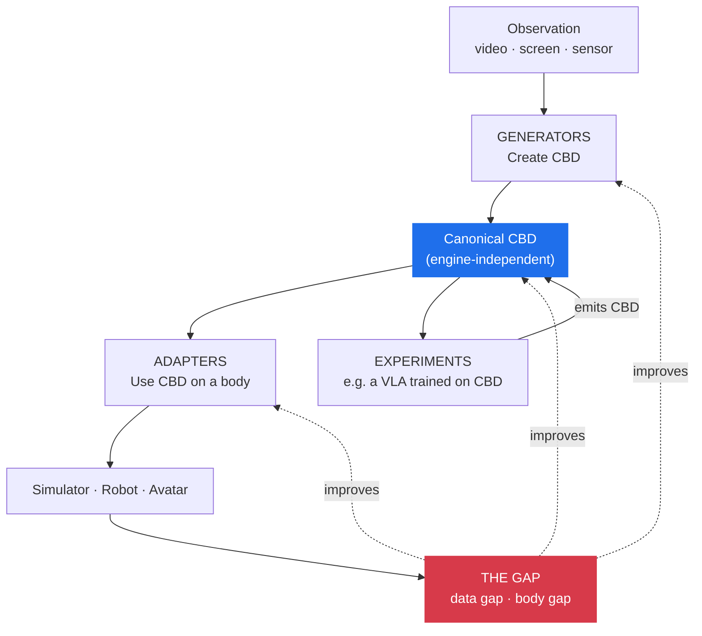

<div align="center">

# Common Behavior Data

**One behavior. Many bodies. Every gap measured.**

An open behavior layer between what a camera sees and what a body can do.
Turn ordinary video into behavior data, train a model on it, run it on a
humanoid, a robot or an avatar — and record **the gap for each body**: what
that body could not do, as a number in its own units.

[](docs/limitations.md)
[](LICENSE)
[](adapters/README.md)
[](https://github.com/Koichi3333/vla-maker-from-cbd)
[](#help-wanted--measure-a-gap)

[](docs/media/technical-concept-deck.pdf)

[日本語](README.ja.md) ·
**[VLA sample](#a-vla-trained-on-cbd)** ·
**[The gap](#the-gap)** ·
[Showcase](showcase/) ·
[Experiments](experiments/) ·
[Concept](docs/concept.md) ·
[Specification](specification/README.md) ·
[Roadmap](docs/roadmap.md) ·
**[Help wanted](#help-wanted--measure-a-gap)**


*Left: an ordinary video, turned into CBD. Right: a VLA trained on CBD, told
"a seated person picks up a glass from the table, drinks from it, and puts it back".*

<sub>From [vla-maker-from-cbd](https://github.com/Koichi3333/vla-maker-from-cbd). The person on the left is not in the training data.
The right is kinematic MuJoCo — poses in sequence, no forces. There are no fingers; the glass attaches once the hand reaches it.
An outside planner guides the hand until it reaches the glass; the lift to the mouth comes from the model.
This is one of 12 trials of this scene — in the other 11 the glass stops at chin height or below.</sub>

</div>

---

## New here? Three minutes

| If you want to… | Go to |
|---|---|
| **See a VLA trained on CBD** | [A VLA trained on CBD](#a-vla-trained-on-cbd), below → [`vla-maker-from-cbd`](https://github.com/Koichi3333/vla-maker-from-cbd) |
| **Understand the one idea that matters** | [The gap](#the-gap) — data gaps, body gaps, and the numbers per body |
| **See one behavior on four bodies** | [`showcase/`](showcase/) — videos first, code later |
| **Help** | [Help wanted](#help-wanted--measure-a-gap) — most items need no GPU |
| **Run the smallest complete example** | [`examples/`](examples/) — two Colab notebooks |
| **Run the current pipeline** | [`generators/`](generators/) → [`adapters/`](adapters/) |
| **Read the data format** | [`specification/`](specification/README.md) |

---

## A VLA trained on CBD

**[`vla-maker-from-cbd`](https://github.com/Koichi3333/vla-maker-from-cbd)** is
the first [experiment](experiments/) built on CBD at real scale. A VLA
(vision-language-action model) takes a camera image and a text instruction and
outputs body motion; this one is NVIDIA GR00T N1.7 (3B), fine-tuned on CBD.

```text
video / mocap ──► CBD ──► VLA (GR00T N1.7, fine-tuned) ──► CBD ──► adapters ──► MuJoCo · Unitree G1 · VRM
                  └ this repository ┘   └ vla-maker-from-cbd ┘     └ this repository ┘
```

**The model does not output any robot's joint angles. It outputs CBD** — 19 bone
rotations plus the hip position, 117 numbers per frame. Putting that motion on a
MuJoCo humanoid, a Unitree G1 or a VRM avatar is the adapter's job, so **no body
needs its own retraining**.

What it measured — held-out scenes, kinematic MuJoCo, every number from its
[results](https://github.com/Koichi3333/vla-maker-from-cbd/blob/main/docs/results.md):

| | Result |
|---|---|
| Hand reaches the object, guided by an outside planner | **0.93** with the goal a VLM picked · 0.94 with the true goal |
| Same, the model alone | 0.51 — it turns toward the object, but reaches it about half as often |
| A VLM picks the requested object in the image | **378 / 378**, including look-alike distractors |
| Instructions with no verbatim match in training | `walks forward` +3.06 m · `crawls on the floor` goes on all fours in 6 of 8 |
| Generated walking, retargeted to a **Unitree G1** through CBD's adapter | median direction residual **0.96°** (the teacher walks: 1.54°) |

What it does **not** claim: physics or a real robot (everything is kinematic),
grasping with fingers, precise reaching without guidance, or beating *"just hold
the current pose"* at predicting video motion (5.53° vs 5.05°). The code is
Apache-2.0; the weights are non-commercial, because GR00T N1.7, AMASS and SMPL
are. Its [help-wanted list](https://github.com/Koichi3333/vla-maker-from-cbd#help-wanted)
has eight open problems, from GPU research to translating log messages.

### Why a body-independent model makes the gap the asset

A model trained for one robot hides that robot's limits inside its weights. A
model that emits CBD leaves them in the open — **one body at a time, at the
adapter, as a number.** The VLA does not know whether it is driving a G1 or a
VRM avatar. The adapter does, and what the adapter reports that body could not
do is the **body gap**. Scale buys bigger models. It does not buy a per-body
record of what each body could not do; that has to be measured, body by body.

The VLA ran straight into the gaps this repository records:

- **A data gap, closed at a price.** CBD's video generator does not measure four
  bones (`chest`, `neck`, both shoulders). To train on video clips, the VLA
  fitted the torso with SMPL (ROMP) — which closed the gap and brought SMPL's
  non-commercial, no-redistribution terms into the training data with it.
- **A body gap.** The G1's waist (±30°) cannot follow the deep bends the
  generated motion asks for.
- **Data gaps, still open.** No finger bones — "held" means the hand came within
  reach. No locomotion phase — so the G1 adapter cannot solve the VLA's walking
  onto the floor. And no CBD bundle could state *"AMASS-derived motion must
  never be redistributed"* about itself until `0.3.0` added the field.

Each of these is a row in the [gap register](docs/compatibility_findings.md).

---

## The gap

The most useful output of this project is not a video. It is the list of
places where behavior stopped being portable — **the gap register**, collected
with numbers in [`docs/compatibility_findings.md`](docs/compatibility_findings.md).

Every gap in it is one of **two kinds**, and the kind decides what you can do
about it:

```text
data gap    the record does not carry it      → closable upstream:
                                                a better generator, a sensor,
                                                a new schema channel

body gap    the two bodies genuinely          → not closable:
            disagree                            measure it and publish the
                                                number, in the target's units
```

A data gap is someone's bug. A body gap is a fact about a 1.32 m robot with no
spine. And the two connect: **a data gap becomes a body gap the moment the body
changes.**

<div align="center">


*One source video → one behavior dataset → four bodies, same timeline. The four
adapters share no code; where the panes disagree is the gap.*
</div>

### The gap map — per body

| Body | Body gaps — measured, not closable | Data gaps it exposed |
|---|---|---|
| **MediaPipe overlay** — the source's own pixels | none: it is the camera's own frame | none visible — it draws what was measured |
| **MuJoCo humanoid** — built to the subject | contact is not resolved (kinematic replay) | absorbed almost all of them |
| **Unity / VRM 1.0** — any avatar, nobody measured it | none found: retargeting from a T-pose rest cost nothing | absorbed almost all of them |
| **Unitree G1** — Isaac Sim, 43 DoF, 1.32 m | motion is *solved*, not copied: **6.87°** mean residual · the set is scaled to the robot, **`scale = 0.685`** · both ankle pitch joints on their limit, **96 / 96** frames (retarget stage) · no neck · three fingers per hand | four identity bones → **0.296 m** between where the image puts the glass and where the hand goes · no support relation → a 110 mm pad instead of a chair · `phase` reads `Idle` for **96 / 96** frames · no force or contact |
| **G1, driven by the VLA** — generated motion | waist **±30°** limits deep bends · walking direction residual **0.96°** median | no locomotion phase → feet not solved to the floor · no finger bones |

The human-shaped bodies absorbed almost everything. **The machine did not**,
and that is what made it worth doing. Scaling the robot instead of the
furniture would have been a fabrication about hardware; the gap is published
instead.

**A new body is a new row in this table.** That is the contribution this
project compounds on — see [Help wanted](#help-wanted--measure-a-gap).

### The data has to say it, too

For a long time the data said none of this. Four bones read as a motionless
torso, 96 frames of `Idle` read as a clip where nothing happened, and
`quality.json` reported `object_coverage: 1.0` for a clip in which one object
entry out of 173 carries a 3D position.

**Since dataset version `0.3.0`, the data declares its own data gaps.** Every
channel carries a tier — `measured` / `derived` / `estimated` / `prior` /
`degenerate` / `absent` — in `manifest.json` and
`quality/channel_provenance.json`, measured from the series rather than
asserted. Body gaps live where they belong, in each adapter's report as
`asked` / `got` / `error` / `tolerance`, because they are a property of
*(this behavior, this body)*, not of the record.

Two things are still open, and stated rather than hidden: **no adapter reads
the tiers yet**, and the G1 adapter's own ledger grades about 30 % of its output
and reports a pass over the whole of it:

```text
stage_provenance, as shipped
  entries       4         the legs it solved, two object placements, one wrist repair
  total weight  1251      of 43 joints × 96 frames = 4128 joint-frames
  evidence      "measured+derived 99.8% >= floor 70%"  → passed
```

That is the same shape of defect this project caught once already — *a
single-point foot check reporting a pass with the toes 87 mm underground* — and
this one is in our own instrumentation. More in
[the concept](docs/concept.md) and the [roadmap](docs/roadmap.md#next-in-band-provenance).

Some corrections worth borrowing, as ideas rather than code: solve a sole as a
**contact polygon, not a point** (penetration 0.118 m → 0.000 m); **publish
what the physics returned**, not what you asked for; **interpolate dropouts**
instead of holding the nearest value.

---

## Help wanted — measure a gap

**This is a one-person project so far, and it needs people.** Every item below
can be taken on by itself, and most need no GPU and no history of the
repository. Each has an issue — comment on it to claim it, so two people do not
build the same thing, or open a
[Discussion](https://github.com/Koichi3333/common-behavior-data/discussions) for
an idea that is not on the list.

| | Task | The gap it closes or measures | GPU? |
|---|---|---|---|
| 🟢 | [#1](https://github.com/Koichi3333/common-behavior-data/issues/1) **Bring a new body.** Load the [sample bundle](examples/human-capture/sample_output/04_behavior_dataset/) into a target we do not have — a robot from MuJoCo Menagerie, an SO-101 arm, Blender, Godot, ROS 2 — and file a [gap report](https://github.com/Koichi3333/common-behavior-data/issues/new?template=portability_finding.md) | a new row in [the gap map](#the-gap-map--per-body) | No |
| 🟢 | [#2](https://github.com/Koichi3333/common-behavior-data/issues/2) **Record a clip with objects and contribute it as CBD.** Seated or standing, fixed camera, through the [video generator](generators/video_to_cbd/) | data is what the VLA lacks most — and only data you own leads to a model that can be used commercially | No |
| 🟠 | [#3](https://github.com/Koichi3333/common-behavior-data/issues/3) **Be the first reader of `0.3.0` provenance.** Make the G1 adapter's [`phases.py`](adapters/isaac_sim_groot_g1/phases.py) trust the declared tier, keeping its own test as a fallback | turns a *declared* data gap into a contract | No |
| 🟠 | [#4](https://github.com/Koichi3333/common-behavior-data/issues/4) **Write the validator** — *"does this bundle declare a tier for every channel it writes?"* — in [`tools/`](tools/) | makes data gaps checkable | No |
| 🔴 | [#5](https://github.com/Koichi3333/common-behavior-data/issues/5) **Give the four torso bones a rotation** — `chest`, `neck`, both shoulders | the largest data gap: 0.296 m on the G1, and the reason the VLA had to bring in SMPL | No |
| 🟡 | [#6](https://github.com/Koichi3333/common-behavior-data/issues/6) **A locomotion phase**, so the G1 adapter can put the VLA's generated walking on the floor | data gap → body gap | No |
| 🟡 | [#7](https://github.com/Koichi3333/common-behavior-data/issues/7) **Finger bone rotations** — asked for by two consumers now, the G1 and the VLA | data gap | No |
| 🟡 | [#8](https://github.com/Koichi3333/common-behavior-data/issues/8) **Make the G1 ledger cover what it grades** (~30 % today) | a gap in our own instrumentation | No |
| 🔵 | **VLA-side problems** — reach without guidance, a physics check, GPUs other than Colab, CI | [`vla-maker-from-cbd` #1–#8](https://github.com/Koichi3333/vla-maker-from-cbd#help-wanted) | some |

> **Pick a behavior. Run it on a new body. Tell us where the gap is.**

The fastest useful contribution takes about thirty minutes: take the sample
bundle, try to load it into a system this project has never heard of, and file
what was missing. A gap with a number attached is worth several without one,
and a failure you documented is worth more than a demo that worked.

Start with [`CONTRIBUTING.md`](CONTRIBUTING.md). Have a robot, simulator, model
or application you would like to connect, or think a schema decision is wrong?
Say so in a [Discussion](https://github.com/Koichi3333/common-behavior-data/discussions) —
that feedback is the most useful thing this project can receive right now.

---

## How CBD works

```text
Video / Screen capture / Sensor / Other observation
        ↓
   Generator               generators/      Create CBD             ← replaceable
        ↓
   Canonical CBD           specification/   engine-independent     ← the asset
        ↓
   Adapter per body        adapters/        Use CBD somewhere      ← replaceable
        ↓
   MuJoCo · Unity · Isaac Sim · Robot · ML dataset · VLA
        ↓
   The gap                 what this body could not do, by how much
        ↓
   Gap register            docs/compatibility_findings.md
        ↓
   Generator / Adapter / Specification improvement
```

The loop at the bottom is the part that matters most, and it is why this
repository keeps failures. What one body teaches gets carried to the others —
**as knowledge, not as shared code**.



Video is emphasised because it is the most **available** observation, not the
most accurate: footage already exists, needs no capture rig, and can be
re-analysed years later by a better model. **Sensors are not the opposite of
this** — they complement video exactly where it is weak: scale, ground truth,
and what video cannot see at all, such as contact, force and torque. And CBD is
**not limited to human body motion**; screen recordings and work procedures are
the same shape, as a [direction](docs/behavior_asset.md#not-only-human-body-motion),
not as code. More: [`docs/behavior_asset.md`](docs/behavior_asset.md).

### One line is one complete sample

`timeline/frames.jsonl` is the file that carries the idea. **One line is one
frame, and one frame is a complete tuple** — which is why a VLA can train on it
with no annotation pass in between:

```jsonc
{
  "frame": 42,
  "timestamp_sec": 3.5,
  "frame_image": "timeline/frames/000042.jpg",                                    // vision
  "caption": { "en": "The person reaches for the cup", "source": "gemini_api" },  // language
  "human": {
    "bone_rotations_xyzw": { "left_upper_arm": [0, 0, 0, 1] },                    // motion
    "hips_position": [0, 0, 0],
    "finger_curls_rad": {}, "joint_angles_deg": {}, "gestures": {}
  },
  "objects": [ { "track_id": "obj_005", "label": "cup", "role": "target",
                 "position_source": "estimated_from_hand" } ],                    // objects
  "interactions": [ { "type": "grasp_candidate", "score": 0.8 } ],                // candidates
  "phase": { "action": "Pick And Place", "phase": "Grasp", "hand": "Right" }      // state
}
```

**Present is not the same as informative**, and that distinction is the thing to
read this format with. In the shipped sample `phase` reads `Idle` for all 96
frames of a pick-and-place clip, and four of the nineteen bone rotations are
identity in every frame because nothing measured them — the data gaps above.
Conventions that change how it should be read:

- **`interaction_events` are candidates**, not ground truth. No adapter may
  promote them.
- **Derived 3D positions carry `position_source`** — inferred depth is always
  marked.
- **Captions are AI-generated**, recorded with the model that produced them.
- **Since `0.3.0`, every channel declares its tier**, as above. Until an adapter
  reads it, a consumer should still test informativeness itself, as the G1
  adapter does in [`phases.py`](adapters/isaac_sim_groot_g1/phases.py).

Full description: [`specification/README.md`](specification/README.md).

---

## Showcase — what actually ran

**[→ showcase/](showcase/)** — the results in video form, each with an honest
note on what worked and where the gap was.

| | Body | The interesting part |
|---|---|---|
| [Video → MuJoCo](showcase/video_to_mujoco/) | MuJoCo humanoid | model and motion stay separate; kinematic replay, no physics claimed |
| [Video → Unity / VRM](showcase/video_to_unity/) | any VRM 1.0 avatar | drives an avatar **nobody measured** |
| [Video → Isaac Sim / G1](showcase/video_to_isaac_g1/) | **Unitree G1 as GR00T drives it** | a machine whose proportions are not negotiable — and the gaps, as numbers |
| [Cross-simulator](showcase/cross_simulator/) | all four at once | four adapters, zero shared code, one timeline |
| [CBD → VLA → CBD](experiments/#vla-maker-from-cbd--a-vla-trained-on-cbd) | MuJoCo humanoid · G1 | a model that **emits CBD**, so every body is reached through the same adapters |

The four adapters share no code and never read each other's output. The only
thing they have in common is `04_behavior_dataset/`. If the panes agree, the
agreement is a property of the representation; where they disagree is the gap.

---

## Repository structure

| Directory | Role | State |
|---|---|---|
| [`generators/`](generators/) | **Create CBD** | video → CBD, working |
| [`adapters/`](adapters/) | **Use CBD on a body** — and report its gap | 4 targets, working |
| [`experiments/`](experiments/) | **Try something with CBD** | **the VLA** ([own repository](https://github.com/Koichi3333/vla-maker-from-cbd)) · open for more |
| [`showcase/`](showcase/) | **See what CBD can do** | 4 results |
| [`examples/`](examples/) | **Initial Minimum Experience** | preserved, runnable |
| [`tools/`](tools/) | **Prepare and manipulate assets** | mostly empty — a validator is wanted |
| [`specification/`](specification/README.md) | **Define Canonical CBD** | experimental, adapter-driven |
| [`docs/`](docs/) | **Explain the architecture and philosophy** — including [the gap register](docs/compatibility_findings.md) | — |

Each has its own README that starts with *what is this, what goes here, input,
output, minimal example*.

Three structural rules worth knowing before you read code:

- **Adapters are self-contained, not DRY.** Retarget, contact, physics,
  placement, validation and reporting live inside the adapter that needs them,
  even when two adapters look similar. Simulator physics and robot bodies differ
  enough that a shared helper becomes quietly wrong for each. See
  [why](adapters/README.md#self-contained-beats-dry).
- **`tools/` is not a place to hide shared adapter logic.** It holds independent
  utilities — video prep, masking, comparison, dataset inspection.
- **Nothing stable depends on an experiment.** An experiment reads CBD and may
  emit CBD; that is all. The VLA lives in its own repository, which is that rule
  at its strongest.

What travels between adapters is the **gap**, written down, not the code:
[`docs/compatibility_findings.md`](docs/compatibility_findings.md).

---

## Where things run

*Colab CLI where the target allows it; a documented machine where it does not.*

| Step | Environment |
|---|---|
| [`generators/video_to_cbd/`](generators/video_to_cbd/) | Google Colab — **CLI recommended** |
| [`adapters/mediapipe_overlay/`](adapters/mediapipe_overlay/), [`mujoco/`](adapters/mujoco/) | Google Colab — CLI, same session |
| [`adapters/unity_vrm/`](adapters/unity_vrm/) | Colab writes the files; Unity plays them locally |
| [`adapters/isaac_sim_groot_g1/`](adapters/isaac_sim_groot_g1/) — retarget, compose | any machine, plain Python |
| [`adapters/isaac_sim_groot_g1/`](adapters/isaac_sim_groot_g1/) — **render, PhysX** | **Google Compute Engine · `g2-standard-16` · 1 × NVIDIA L4** · Isaac Sim 6.0 |
| [`vla-maker-from-cbd`](https://github.com/Koichi3333/vla-maker-from-cbd) — training, inference | Google Colab A100, through the Colab CLI · a CPU smoke test runs on a laptop |

Isaac Sim is the one exception to Colab, because it needs an RTX GPU the runtime
does not expose, a container measured in tens of gigabytes, and a shader cache
that survives between runs. Its README states the machine at the top, and **its
outputs are committed**, so the result is readable by someone who never touches
a GPU. Rules for new targets: [`docs/runtime_environments.md`](docs/runtime_environments.md).

### Running the current pipeline

```bash
colab new -s cbd
colab upload -s cbd ./source_video.mp4 /content/source_video.mp4
colab exec   -s cbd -f cbd_generator_video_to_cbd.ipynb        --timeout 1800
colab exec   -s cbd -f cbd_adapter_mediapipe_overlay.ipynb     --timeout 1800
colab exec   -s cbd -f cbd_adapter_mujoco.ipynb                --timeout 1800
colab exec   -s cbd -f cbd_adapter_unity_vrm.ipynb             --timeout 900
colab download -s cbd \
  /content/human_behavior_demo_2_0/cbd_dataset.zip ./cbd_dataset.zip
colab stop -s cbd
```

`cbd_dataset.zip` is the **only** thing passed between them — the generator
knows nothing about MuJoCo or VRM, and each adapter reads canonical CBD and
nothing else. The G1 adapter takes the same zip directly:

```bash
python adapters/isaac_sim_groot_g1/cbd_adapter_groot_g1.py --dataset ./cbd_dataset.zip
```

And so does the VLA, to build its training data
([bring your own CBD](https://github.com/Koichi3333/vla-maker-from-cbd#4-bring-your-own-cbd)).
Details: [`generators/README.md`](generators/README.md) ·
[`adapters/README.md`](adapters/README.md).

---

## Initial Minimum Experience

> The original examples are preserved as the smallest end-to-end demonstrations
> of the Common Behavior Data concept.

[`examples/`](examples/) holds the two notebooks the project started from,
**kept as they are**. They run top to bottom in a fresh Colab runtime with no
local setup, and their outputs are committed.

| Demo | Direction | |
|---|---|---|
| [A — Human Capture](examples/human-capture/) | video → CBD → MuJoCo / Unity | [](https://colab.research.google.com/github/Koichi3333/common-behavior-data/blob/main/examples/human-capture/human_behavior_demo_2_0.ipynb) |
| [B — Language to Motion](examples/language-to-motion/) | CBD → learning → generated CBD | [](https://colab.research.google.com/github/Koichi3333/common-behavior-data/blob/main/examples/language-to-motion/human_behavior_vla_trainer.ipynb) |

They are not being modernised into the current layout — rewriting them would
destroy what they are useful for. They are the project's origin, its first
architecture, and the baseline every later adapter is compared against.

> ⚠️ **Demo B is not a general-purpose VLA.** It is a small VLA-like learning
> prototype that demonstrates memorisation, interpolation and
> language-conditioned generation, and does not generalise to unseen
> instructions. It is the small ancestor of
> [`vla-maker-from-cbd`](https://github.com/Koichi3333/vla-maker-from-cbd),
> which does the same loop at 3B parameters.

**Examples vs. Showcase vs. Experiments:** examples answer *how did the initial
CBD experience work*, showcase answers *what can CBD do*, experiments answer
*what happens if we try this*.

---

## Current adapters

| Adapter / connection | Status | Evidence |
|---|---|---|
| Video → CBD | **Available** | [`generators/video_to_cbd/`](generators/video_to_cbd/) |
| CBD → MediaPipe overlay | **Available** | [`adapters/mediapipe_overlay/`](adapters/mediapipe_overlay/) — redrawn from the dataset |
| CBD → MuJoCo humanoid | **Available** | [`adapters/mujoco/`](adapters/mujoco/) — kinematic replay (`qpos` + `mj_forward`) |
| CBD → Unity / VRM | **Available** | [`adapters/unity_vrm/`](adapters/unity_vrm/) — VRMA export, UniVRM SimpleVrma playback |
| CBD → Isaac Sim / GR00T, Unitree G1 | **Available** | [`adapters/isaac_sim_groot_g1/`](adapters/isaac_sim_groot_g1/) — 43-DoF retarget under the URDF's limits, USD stage, PhysX pass, GR00T-LeRobot dataset. The adapter itself runs no policy |
| CBD → behavior dataset | **Available** | `frames.jsonl` + CSVs |
| CBD → VLA → CBD | **Experimental, external** | [`vla-maker-from-cbd`](https://github.com/Koichi3333/vla-maker-from-cbd) — GR00T N1.7 fine-tuned on CBD, emits CBD; kinematic evaluation only |
| Language → CBD | **Experimental** | the VLA above, and Demo B as its small prototype |
| CBD → other robot embodiments (e.g. SO-101) | Planned | target platform not yet fixed — [help wanted](#help-wanted--measure-a-gap) |
| CBD ↔ LeRobot · ROS 2 | Partly | CBD → LeRobot exists in the VLA repository and the G1 adapter; ROS 2 is a contributor target |

Nothing marked *Planned* exists as code here — see [`docs/roadmap.md`](docs/roadmap.md).

---

## Roadmap

The next question is not more human capture, and it is no longer whether the
representation can reach a new body — the G1 and the VLA say it can, at a cost
they can name. It is whether the data can **state its gaps itself**, and
whether behavior intent survives on a body that is nothing like a human.

1. **Provenance in the data — generator done, consumers open.** `0.3.0` writes
   a tier per channel plus `episode_kind` for observed vs generated. What is
   missing is the half that makes it a contract: an adapter that reads it, a
   validator, the G1 ledger's own coverage, and producers of generated CBD —
   Demo B and the VLA — that set `episode_kind`.
2. **Whole-body reach.** Rotation for the four bones that carry none is the
   binding constraint on the robot, and the reason the VLA brought in SMPL.
3. **Force and contact channels.** Whether they belong on the same timeline or
   in a layer joined by timestamp is open — best answered with a real sensor.
4. **More bodies, deliberately unlike the ones we have.** A body similar to an
   existing one teaches almost nothing about the gap; the G1 taught a great deal
   precisely because it was not a human-shaped figure.

Full plan: [`docs/roadmap.md`](docs/roadmap.md).

## Limitations

The short version:

- Single-person capture; depth is monocular estimation
- Interaction detection is heuristic **candidates**, not ground truth
- MuJoCo playback is **kinematic replay**, not physically correct contact
- The G1 adapter runs **no policy**; it writes a dataset one could be trained on
- The VLA is evaluated **kinematically only**; its precise reaching needs
  outside guidance, and its weights are non-commercial
- Demo B memorises and interpolates; it does not generalise
- No sim-to-real, no robot task success, no grasp correctness claim
- Finger angles are approximations from hand landmark curl
- Four bones plus `phase` are **populated without being informative** —
  declared as `degenerate` since `0.3.0`, but declaring a gap does not close it,
  and no adapter reads the declaration yet
- The schema is unstable and will change

Full list with reasoning: [`docs/limitations.md`](docs/limitations.md).

## Why open?

Large organisations will win on dataset scale, model size, dedicated hardware,
and vertically integrated robot stacks. This project is not competing there.

The hypothesis it *is* testing is that there is durable value in the opposite
properties: neutrality, interoperability, open specifications, and
adapter-based integration — a layer that belongs to nobody in particular, and
is therefore usable by everybody.

And one property none of those organisations is competing on: **the gap, per
body, measured and published.** Data that declares how each of its channels was
obtained, and adapters that publish what each body could not do, as numbers. A
vertically integrated stack has one body and no reason to publish its gap. An
open layer between many bodies has every reason to — and the more bodies it
reaches, the more that record is worth.

The long-term goal is not a video-conversion repository and not a human-motion
repository. It is:

> **A growing collection of reusable behavior assets, adapters, experiments —
> and the gaps between bodies, measured.**

That is the design goal, stated as a goal. It is not traction, and this
repository will not pretend otherwise. More in [`docs/ecosystem.md`](docs/ecosystem.md).

## Why I'm building this

Robotics, simulation, motion, and AI ecosystems are advancing quickly, but
behavior data is still usually tied to a particular tool or embodiment. I am an
independent builder exploring whether a small, open, reusable behavior layer can
make experiments easier to connect and extend — starting with demos that already
work end to end, a VLA that trains on it, and a careful record of where the idea
breaks. If that is a question you care about too, [come and help](#help-wanted--measure-a-gap).

## License and third-party materials

The repository's original source code and documentation are licensed under
**Apache-2.0** ([`LICENSE`](LICENSE)) unless otherwise noted.

Datasets, model weights, demo media, source videos, VRM assets, robot assets and
third-party materials may carry separate terms — including the sample outputs in
`examples/*/sample_output/`. See
[`THIRD_PARTY_NOTICES.md`](THIRD_PARTY_NOTICES.md) before redistributing
anything from this repository. The VLA's weights and training data have their
own, non-commercial terms, stated in
[its repository](https://github.com/Koichi3333/vla-maker-from-cbd#license).
