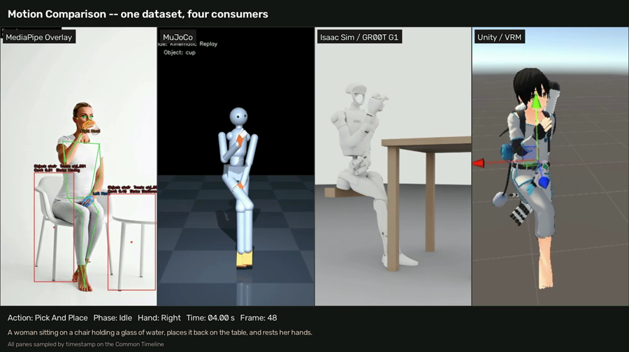

# Concept

[← back to README](../README.md) · [日本語（概要）](../README.ja.md)

## The problem

Behavior data does not usually fail loudly. It fails **silently**.

A dataset loads. Every field parses. An adapter runs to completion and produces
a trajectory a simulator will happily play. And somewhere inside it, four of
nineteen bones never rotated — not because the body was still, but because
nothing measured them, and the file has no way to say so.

Everything this project has learned sorts into **two kinds of gap**, and the
line between them is the one distinction worth memorising before reading further:

```text
data gap    the record does not carry it
            → closable upstream: a better generator, a sensor, a schema channel

body gap    the two bodies genuinely disagree
            → not closable: it can only be measured and published as a number
```

A data gap is someone's bug. A body gap is a fact about a 1.32 m robot with no
spine, and pretending otherwise would be a fabrication about hardware. Confusing
the two is how a project either hides its failures or tries to fix the
unfixable.

### Data gaps — the record does not carry it

Not a hypothetical. This is this repository's own shipped sample
([`examples/human-capture/sample_output/04_behavior_dataset/`](../examples/human-capture/sample_output/04_behavior_dataset/)):

| What is wrong with it | What the data says | What a consumer concludes |
|---|---|---|
| `chest`, `neck`, `left_shoulder`, `right_shoulder` are identity in all 96 frames (4 of 19) | a quaternion, the same value every frame | "the torso did not move" |
| the clip is a pick-and-place; `phase` reads `("Pick And Place", "Idle", "Right")` in all 96 frames | a populated field | "nothing happened" |
| `interaction_events.csv` has a header and no rows; `behavior_summary.json` has `events: []` | an empty table | "no contact occurred" |
| 1 of 173 per-frame object entries carries a 3D position at all, and that one is `proxy_canonical: [NaN, NaN, 0.3]` | `object_coverage: 1.0` in `quality/quality.json` | "objects are fully covered" |
| canonical space is metre-ish, derived from monocular estimation | unitless numbers | "these are metres" |
| nothing records the source's terms, or whether an episode was observed or generated | no such field | whatever they assume |

Every row is the same failure: **a value a consumer cannot distinguish from a
measurement.** Not a parse error, not a missing file — a confident number with
no provenance attached. The one place this repository got it right is
`position_source` on derived object positions, and that field covers exactly one
of the rows above. Every row is now **declared** by the generator as of `0.3.0`
— which changes what a consumer can find out, and changes none of the
underlying gaps.

The cost is not integration work. It is a consumer that is wrong and cannot find
out.

### Body gaps — the two bodies genuinely disagree

These are not defects, and none of them has an upstream fix. Every one was
measured on the Unitree G1, because a human-shaped target absorbs almost
anything and a machine does not
([findings](compatibility_findings.md#target-constraints--reported-not-fixed)):

| Where the bodies disagree | What it costs, in the target's own units |
|---|---|
| a fixed-length limb cannot reproduce a reach measured in metres | the motion is *solved* by direction matching, not copied — **6.87° mean** residual, 65.08° worst (palm normal) |
| a 1.32 m robot cannot use furniture sized for a taller subject | the **set** is scaled instead, by one published number (`scale = 0.685` in v2). Scaling the robot would be a fabrication about hardware |
| the robot runs out of ankle travel on a seated clip | on the retarget, **both ankle pitch joints sit on their limit in all 96 frames** — not solver error, there is no more travel ([needs re-cutting against v2](compatibility_findings.md#target-constraints--reported-not-fixed)) |
| a 29-DoF G1 has no neck, and a Dex3 hand has three fingers | head pose and two fingers per hand are **dropped**, and the drop is reported |
| kinematic replay is not contact (MuJoCo) | playback is `qpos` + `mj_forward`; physical correctness of contact is **not claimed** |

The rule for these is the opposite of the rule for data gaps: **publish the
number, never silently approximate.** A residual stated in the robot's own
degrees and millimetres is a result. The same residual smoothed away is a lie.

### The two are connected, and that is the interesting part

> **A data gap becomes a body gap the moment the body changes.**

The four identity bones are a data gap — nothing in the capture distinguishes
chest, neck and clavicles from the shoulders. Put that record on a machine and
it stops being a missing field and becomes a **0.296 m** disagreement between
where the image puts the glass and where the robot's hand goes, because a waist
that can only yaw cannot reach to the side. Put the same record into a model and
the gap has to be closed before training can even start:
[`vla-maker-from-cbd`](https://github.com/Koichi3333/vla-maker-from-cbd) emits
19 CBD bone rotations, and for its video clips it filled the four that canonical
CBD never measures by fitting SMPL (ROMP) — which closed the gap, and brought
SMPL's non-commercial, no-redistribution terms into the training data with it.
Nothing in the CBD bundle said the fill was needed; the VLA had to find out.

That is why provenance comes before re-embodiment in
[the roadmap](roadmap.md#next-in-band-provenance). A data gap you have declared
is a known cost on every body you later try. A data gap you have not declared is
rediscovered by each one, as a number nobody can explain.

## The question

> **Can behavior data say where it breaks?**

Not *can behavior be shared* — that turned out to be the easy half, and it is
largely answered (below). The open question is whether a representation can
carry its own honesty: whether a consumer that never reads this README, and
never talks to whoever captured the clip, can still tell a measurement from an
estimate from a value that means nothing at all — and whether it can tell a
**data gap** it might close from a **body gap** it has to live with.

Common Behavior Data (CBD) is an attempt to answer that empirically, by building
the layer, driving it into real consumers, and measuring what each one had to
invent because the data would not tell it.



*The current evidence: one behavior dataset, four consumers that share no code,
one timeline. The fourth is a robot embodiment that was never measured for this
motion — adding it cost one adapter, and the cost is named in the
[findings](compatibility_findings.md).*

## The part that turned out to be easy

The problem this project started from was the N × M one: every producer wired to
every consumer, each pair a bespoke integration.

```text
Without a shared layer          With a shared layer

vision ──┬──▶ simulator         vision ──┐
         ├──▶ avatar                     ▼
         └──▶ robot            ┌──────────────────┐
model  ──┬──▶ simulator        │ behavior layer   │
         ├──▶ avatar           └──────────────────┘
         └──▶ robot                      │
                                ┌────────┼────────┐
N × M integrations              ▼        ▼        ▼
                            simulator  avatar   robot
                                 N + M adapters
```

**That worked.** Four adapters read the same dataset, share no code, and never
read each other's output. The hardest of them — a Unitree G1, a machine whose
proportions are not negotiable — was added **without changing the representation
at all**. Engine independence is not the open question any more; it is a result.

It is still the right architecture, and rule 2 below still holds. It is just no
longer the interesting claim, because a common format is the part of this
problem that many groups are working on, several of them far better resourced
than this one.

## What is not easy

The G1 adapter did not only transfer the motion. It built the machinery to say
how much of that motion was still CBD's — a provenance ledger that tags every
quantity it writes
([`provenance.py`](../adapters/isaac_sim_groot_g1/provenance.py)):

```text
measured     canonical CBD has it
derived      geometry from canonical CBD
prior        a class-level constant (the object catalog, anthropometry)
synthesized  the adapter authored it, to keep the target self-consistent
unavailable  nothing filled it -- a defect, not an outcome
```

It weights each entry by channels × frames, reports the fraction still traceable
to the dataset, and **fails its own run** when that fraction drops below 70 %,
because *"Below the floor the run is not evidence any more."* It detects a
degenerate channel rather than trusting it: `cbd_phase_is_informative()` returns
false when every frame carries the same label, and the adapter then re-derives
phase from wrist excursion and records the result as `derived`, never writing it
back as an observed `grasp`. Alongside it, `deviation.py` states every
discrepancy as `asked` / `got` / `error` / `tolerance` / `how`, in the robot's
own units.

This is the right machinery, and it is on the wrong side of the boundary. It
lives inside one target, so the next target inherits none of it, and canonical
CBD never learns what it found. And because it was built target-first, its
coverage is narrower than the floor it reports:

```text
stage_provenance, as shipped (07_groot_g1_v2/adapter_report.json)

  entries        4            joint.legs, two object positions, joint.continuity
  total weight   1251         of 43 joints × 96 frames = 4128 joint-frames
  ratio          derived 0.9984 / synthesized 0.0016 / measured 0.0000
  evidence       "measured+derived 99.8% >= floor 70%"   → passed
```

The ledger instruments the quantities this stage **corrected** — the legs it
solved for floor contact, the objects it placed, one wrist run it interpolated.
The arm, torso and waist joints that come straight from the retarget, which are
the bulk of the trajectory, appear in it nowhere. `measured` reads `0.0000`
because no `measured` call site is reached on the path that ships, not because
the dataset was weighed and found empty.

So the honest version of the headline is worse than a bad score: **the evidence
floor passed at 99.8 % over about 30 % of the output.** It is the same failure
the adapter already caught once elsewhere and wrote down — *the single-point
check was reporting a pass with the toes 87 mm underground.* A check that grades
a subset and reports a total is the shape of defect this project exists to find,
and it is in this project's own instrumentation.

What the adapter *does* report, in the robot's own units, is solid: 0.18° RMSE
between what it commanded and what PhysX returned, nine deviation checks with
none failing, `scale = 0.685` on the furniture because a 1.32 m robot cannot use
a taller subject's, 6.87° mean direction residual on the retarget, and 0.296 m
of hand-vs-image disagreement caused by the four bones that carry no rotation.

By this repository's own rule, all of it is the signal: adapters drive the
specification. The vocabulary exists, the detection exists, the floor exists.
What is missing is that they are **one adapter's private code** instead of the
representation's contract — so nothing upstream is obliged to fill them in, and
nothing downstream can rely on them.

## What CBD is

An **experimental open behavior representation** for interoperable robotics,
simulation, AI, and motion applications.

Concretely, today, that means:

- a **canonical, engine-independent** description of what a body and the objects
  around it are doing, over a common timeline
- with **language and phase aligned to the same timeline**, so a frame is a
  complete observation rather than a bag of numbers
- consumed through **adapters**, so engines and embodiments are peripheral, not
  central
- and — the part being built now — with **provenance in the data, per channel**,
  so a consumer can tell measurement from estimation from nothing at all without
  reading prose

The fourth item is **half built**. Dataset version `0.3.0` writes a tier for
every channel the generator produces, including the ones that are not there, and
declares whether an episode was observed or generated — so most of the table at
the top of this page is now stated by the data rather than by this page. What is
not done is the other half: **no adapter reads it**, there is no validator, and
the committed sample output predates it. A declaration nothing depends on is a
claim, not a contract. See
[the roadmap](roadmap.md#next-in-band-provenance).

## What CBD is not

- **Not a standard.** No specification body, no version 1.0, no adoption. The
  schema changes when an adapter proves it should.
- **Not a dataset.** Datasets are one thing you can express in CBD. The name is
  deliberately *Common Behavior Data*, not *Common Behavior Dataset* — the
  representation is broader than any corpus captured with it.
- **Not only a representation, either.** The durable asset is the representation
  **plus** the register of what broke on the way to each target, with numbers. A
  corpus can be recaptured or regenerated; "a reach to the subject's side comes
  out as a reach to the robot's front, and here is the 0.296 m" cannot.
- **Not a motion capture product.** Demo A uses off-the-shelf vision models. The
  interesting part is the layer they write into, not the capture quality.
- **Not a general-purpose VLA.** Demo B is a small learning prototype, and
  [`vla-maker-from-cbd`](https://github.com/Koichi3333/vla-maker-from-cbd) is a
  research preview evaluated kinematically, whose precise reaching depends on
  outside guidance. See [limitations](limitations.md).

## The core design rules

Two, in order of how often they are violated.

### Rule 1 — never let a consumer mistake a filled value for a measured one

```text
Every channel declares which it is:

  measured      the source actually carried it
  derived       computed from something measured
  estimated     inferred under a model or assumption
  prior         a class-level constant (catalog, anthropometry)
  synthesized   authored to keep a consumer self-consistent
  degenerate    written, but carrying no information
  absent        not written at all

The failure this forbids is not a missing value.
It is a present value that cannot be told apart from a measurement.
```

None of these words are new. Five are the tiers the G1 adapter already defines
in [`provenance.py`](../adapters/isaac_sim_groot_g1/provenance.py) (its
`unavailable` is `absent` here), `estimated` is what `position_source` already
distinguishes, and `degenerate` is the adapter's own term too —
[`phases.py`](../adapters/isaac_sim_groot_g1/phases.py) says *"canonical phase
is degenerate (one label for every frame)"* and tests for it with
`cbd_phase_is_informative()`.

That is the whole argument for this rule: **every one of these distinctions has
already been invented by a consumer that needed it**, separately, downstream,
because the data would not make them. `degenerate` has the most immediate
effect — the four identity bones and the 96 frames of `Idle` are the same defect,
a populated field with nothing in it — and today each target has to detect it
again, by hand, from the numbers.

### Rule 2 — route producers and consumers through the behavior layer

```text
Do not build:            Prefer:
  Language → Unity         Language
  Language → MuJoCo           ↓
  Language → Robot         Behavior
                              ↓
                         Embodiment / engine-specific adapter
```

Every direct connection between a producer and a consumer has to be rebuilt for
the next pair. Every connection routed through the behavior layer is one the
next consumer inherits for free.

This is also why MuJoCo and Unity appear in this project as *adapters* and never
as the canonical model. `motion.npz` is a projection of the behavior data.
`motion.vrma` is a projection of the behavior data. Neither is the source of
truth, and either could be regenerated from scratch.

## Why two demos, in opposite directions

Demo A (video → CBD) alone would just be motion capture with extra files.

Demo B (language → CBD) alone would just be a small motion generation model.

Together they test something more specific: **the same representation that
describes observed behavior can be the training corpus for generating behavior,
and generated behavior can flow back out through the same adapters.**

That held — and it is also the sharpest illustration of rule 1. Generated
episodes use the same schema and the same adapters, and **the format does not
record that they are generated.** As
[`specification/README.md`](../specification/README.md#observed-vs-generated)
puts it: *the format will not stop you.* A corpus that mixes observed and
generated behavior is indistinguishable from one that does not — convenient for
the demo, unacceptable for a training set.

## Where this is going

Two steps, in this order, because the first is a precondition for trusting the
second.

**1. Provenance in the data.** Move the vocabulary, the degeneracy test and the
evidence floor out of one adapter and upstream: into canonical CBD as
per-channel provenance, and into the adapter contract as a declaration of what a
target could not represent. A schema and generator change, no GPU required, and
it makes every finding in the register machine-readable instead of prose. It
also fixes the ledger's own coverage, which currently grades about 30 % of the
output and reports a total.

**2. Does the abstraction survive a change of embodiment?** Half-answered. The
G1 took canonical CBD onto a real robot's kinematics at a stated cost — but the
adapter **runs no policy**, so nothing has yet been asked to accomplish
anything.

```text
Reach → Grasp → Lift → Carry → Place → Release
```

A robot arm has no spine, no shoulder blade and no fingers; copying human joint
angles onto it is meaningless. What might transfer is that intent sequence, as
behavior intent plus an end-effector representation, re-embodied by an adapter.
The success criterion is stated in advance in the [roadmap](roadmap.md): **task
success in simulation**, not visual similarity to the human demonstration.

Step 1 before step 2 is deliberate. A policy trained on a corpus that cannot
distinguish a measurement from a derived guess will still produce a number, and
that number will not mean anything. The second consumer makes this concrete:
[`vla-maker-from-cbd`](https://github.com/Koichi3333/vla-maker-from-cbd) trains
on CBD and **emits CBD** — 19 bone rotations plus the hip position — and four of
those 19 are the bones canonical CBD never measures. Trained on video-derived
CBD as it ships, the target for them would be a constant. The VLA avoided that
only by fitting SMPL to its own clips: a fix, and a licence, that live outside
CBD and that no CBD bundle records.

---

**Next:** [Architecture](architecture.md) · [Specification](../specification/README.md) · [Limitations](limitations.md)
